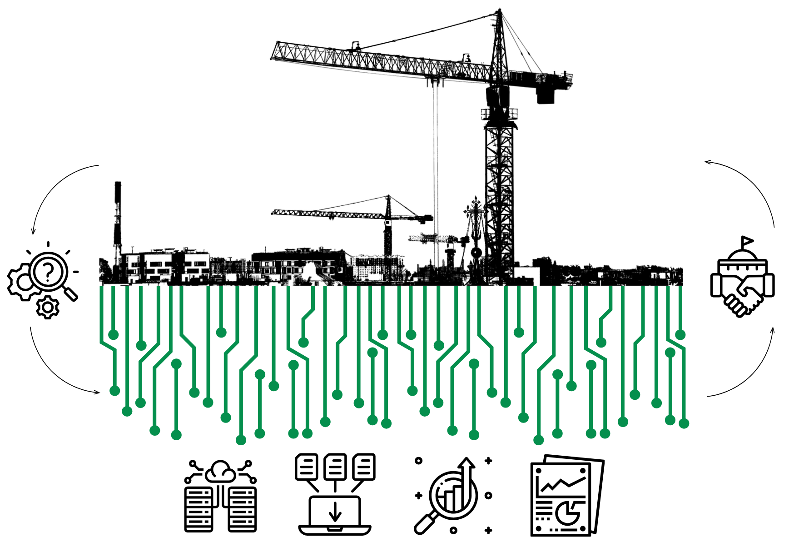
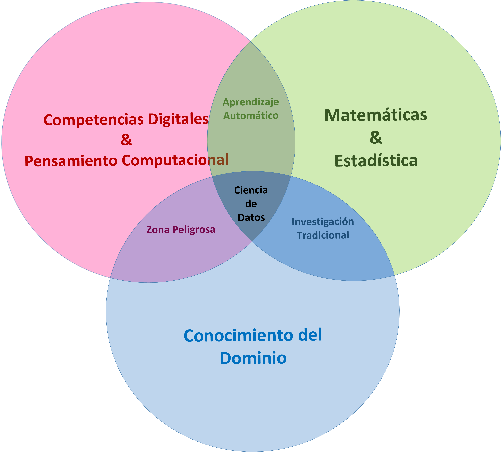
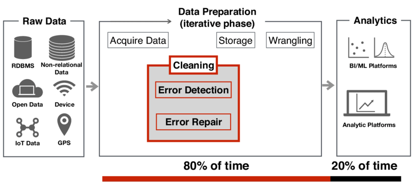
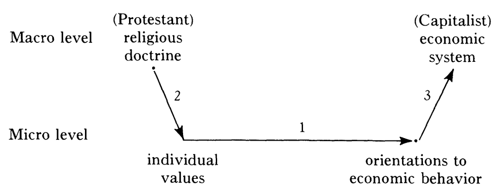
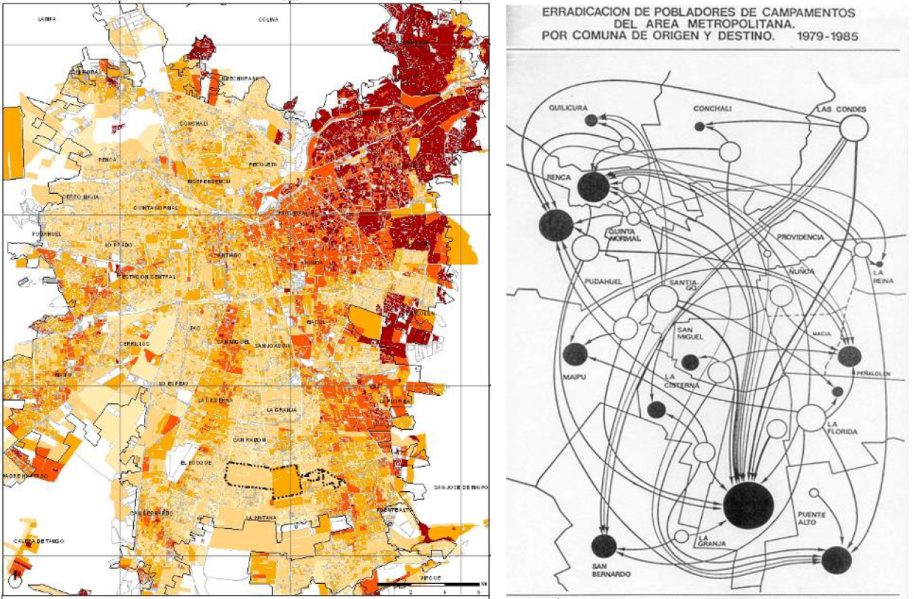
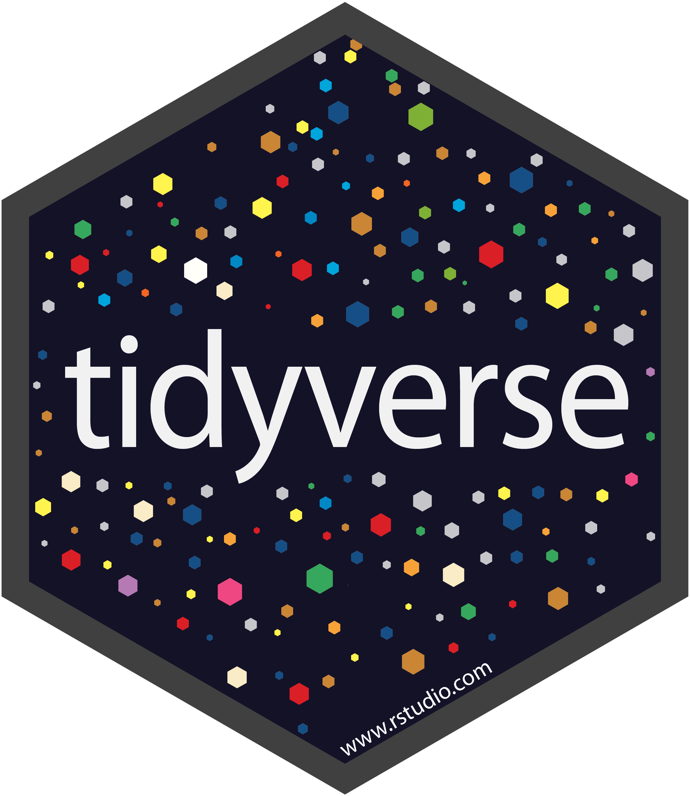
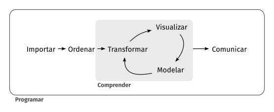
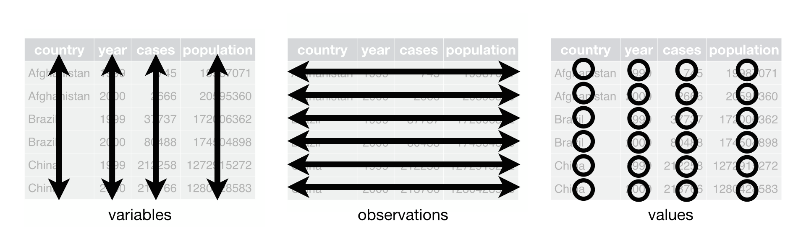
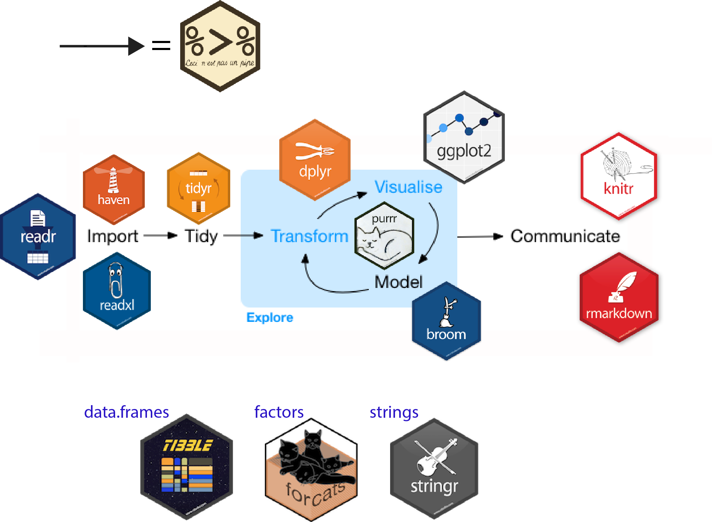

# Estructura de la presentación

1.  [Presentación del curso](#presentación)

2.  [¿Qué es la ciencia de datos?](#cienciadatos)

3.  [El flujo tidyverse](#flujotidy)

4.  [Preámbulo del curso](#preambulo)

5.  [Programa del curso](#programa)

6.  [Resumen de la sesión](#resumen)

# Presentación del curso {#presentación}

## Sobre mí

:::::: columns
::: {.column width="50%"}
-   **Formación**
    -   Sociólogo y Magíster en Desarrollo Urbano
    -   Actualmente curso un diplomado en Estadística
-   **Especialización**
    -   Metodología Cuantitativa
    -   Moldeamiento estadístico
    -   Sociología Urbana
-   **Experiencia**
    -   Investigación empírica cuantitativa en COES y Fondecyt
    -   Docencia en RStudio, Ciencia de datos, Metodología Cuantitativa
:::

:::: {.column width="50%"}
::: incremental
{width="100%"}
:::
::::
::::::

## Sobre ustedes

-   Nombre

-   Proyecto de tesis

-   Especialización teórica y metodológica

-   Experiencia previa en análisis de datos

-   Expectativa sobre el curso

## Modalidad del curso

:::::: columns
::: {.column width="50%"}
-   Sesiones

    -   12 en total entre el 14 de agosto y el 11 de diciembre

    -   Horario original: incluye 3 bloques de 1 hora cada uno

    -   **Horario adaptado: 2 bloques**

        -   Parte teórica: entre 10:50 y 11:50

        -   Parte práctica: entre 11:55 y 14:10

-   Preguntas y participación

    -   Preguntas cortas en cualquier momento

    -   Preguntas elaboradas en las transiciones

    -   Asignación de décimas a quienes planteen buenas preguntas y participen
:::

:::: {.column width="50%"}
::: fragment
-   Foco del curso

    -   Ciencia de datos aplicada a problemas reales

    -   Comprensión del ***por qué*** y no tanto el *como* hacemos las cosas

    -   Hoy es más sencillo que antes programar (IA generativa)
:::
::::
::::::

<!-- ========================== -->

# ¿Qué es la ciencia de datos? {#cienciadatos}

## Definición

:::::: columns
:::: {.column width="50%"}
::: incremental
-   La ciencia de datos (*data science*) es un área multidisciplinaria que permite convertir datos procesados y sin procesar en entendimiento, comprensión y conocimiento.
    -   dato $\to$ información
-   ¿Para qué?: para realizar análisis que informen patrones y tendencias sobre los datos; que sirven para responder preguntas de investigación y diagnosticar problemas sociales.
-   En este sentido, la ciencia de datos es una herramienta para las ciencias sociales y la sociología
:::
::::

::: {.column width="50%"}

:::
::::::

## Contexto

Transición de la era de información analógica a la digital. Dos tendencias simultaneas:

::: incremental
1.  Explosión de la producción y almacenamiento de la información digital $\to$ ***big data.***

2.  Crecimiento en el acceso al poder computacional $\to$ ***microprocesadores (CPU)***
:::

::: fragment
Crecimiento del volumen de los datos + complejización de los procedimientos computacionales + dificultad del dominio en la estadística = **necesidad de especialistas**

{fig-align="center" width="60%"}
:::

## Ciencia de datos y Sociología

::: incremental
-   La sociología genera los objetos y las preguntas de investigación, la ciencia de datos sólo es una herramienta para producir información que ***contribuye*** a dar una respuesta.

-   Por lo tanto, en nuestro contexto sociológico, **no aspiramos a convertirnos en *data scientist***.

-   ¿Cuál es el objeto de estudio de la ciencia de datos?
:::

::: fragment
#### 👉Recordar que los problemas de investigación en sociología reflejan una **inquietud personal** y una **preocupación pública** sobre algún problema social $\to$ “Imaginación sociológica” (Wright Mills, 1959).

{fig-align="center" width="50%"}
:::

## Ciencia de datos y Sociología

:::::: columns
::: {.column width="80%"}

:::

:::: {.column width="20%"}
::: {.fragment style="text-align:right"}
La ciencia de datos [descubre patrones]{.underline}, **la sociología los explica y los comprende**
:::
::::
::::::

<!-- ========================== -->

# El flujo Tidyverse {#flujotidy}

## Definición ¿qué es el flujo Tidyverse?

::::: columns
::: {.column width="50%"}
-   Es un flujo de trabajo de datos que utiliza una estructura típica que opera en base un conjunto de paquetes de R diseñados para procesar y analizar datos.

-   "Tidy" significa ordenado, alude a la forma que debe tener una base de datos

-   ¿R Base v/s Tidyverse?: no es una dicotomía, son en muchos sentidos complementarios
:::

::: {.column width="50%"}
{fig-align="center" width="60%"}
:::
:::::

## Componentes o fases del flujo

:::::: columns
:::: {.column width="50%"}
::: incremental
1.  Primero, es necesario **importar** los datos a R, generalmente cargándolos en un data frame.

2.  Una vez importados, se deben **ordenar**, lo que significa estructurarlos de forma consistente: cada columna es una variable y cada fila una observación.

3.  El siguiente paso es **transformar** los datos, es decir, filtrar, crear nuevas variables y recodificar valores. La combinación de ordenar y transformar se conoce como **manejar o domar** los datos (**data wrangle**).

4.  Con los datos preparados, generamos conocimiento a través de la **visualización** y el **modelado**. Con la visualización descubrimos patrones inesperados y planteamos nuevas preguntas, aunque no escala bien. Con los modelos respondemos preguntas precisas y escalan eficientemente, pero se limitan a sus supuestos y no generan sorpresas.

5.  Finalmente, la **comunicación** es una etapa crítica para compartir los resultados obtenidos.
:::
::::

::: {.column width="50%"}

:::
::::::

## ¿Por qué el flujo Tidyverse?

:::::: colums
::: {.column width="50%"}
### Datos ordenados o *tidy data* tienen un formato estandarizado:

1.  Cada variable en una columna.

2.  Cada observación/registro/individuo en una fila diferente.

3.  Cada celda con un único valor.

4.  Cada conjunto o unidad observacional conforma una tabla.


:::

:::: {.column width="50%"}
::: fragment
### Existe un gran ecosistema y comunidad alrededor (+ IA lo reconoce)


:::
::::
::::::

# Preámbulo del curso {#preambulo}

## Análisis exploratorio de datos

:::::: columns
:::: {.column width="70%"}
*“Es preferible una [respuesta aproximada a la pregunta correcta]{.underline}, que frecuentemente es formulada de manera imprecisa, que una respuesta exacta a la pregunta incorrecta, que siempre puede ser formulada de manera precisa.*” — John Tukey (en Wickham & Grolemund, 2017)

::: incremental
El **Análisis Exploratorio de Datos – EDA**, por sus siglas en inglés, es un proceso de comprensión inicial de los datos.

-   Desde una perspectiva sustantiva, queremos **interrogar los datos** desde nuestras preguntas de investigación. Buscamos interar:

    -   Generar preguntas acerca de tus datos.

    -   Buscar respuestas visualizando, transformando y modelando tus datos.

    -   Usar este conocimiento para refinar y/o generar nuevas preguntas

-   Desde una mirada estadística buscamos la **varianza**, en dos sentidos:

    -   ¿Qué tipo de ***variación*** existe dentro de cada una de mis variables?

    -   ¿Qué tipo de ***covariación*** ocurre entre mis diferentes variables?
:::
::::

::: {.column width="30%"}
```{r}
#| echo: true
#| fig-width: 5
#| fig-height: 4

library(tidyverse)
library(datos)

ggplot(data = diamantes) +
  geom_bar(mapping = aes(x = corte))

```
:::
::::::

## El flujo Tidyverse en la práctica

```{r}
#| output-location: column
#| column: page
#| echo: true
#| fig-width: 6
#| fig-height: 4

library(elsoc)
library(tidyverse)
load("../0-datos/elsoc_base.RData")

# 1. Procesamiento 
cob_inter_nse <- elsoc_base %>% 
  pivot_longer(cols = c(spbi_reco, arra_fisi, soci_reco, conf_veci)) %>% 
  prop(value == "Alto", by = c(ola, name, repu_terr), na.rm = TRUE) %>%
  mutate(name = recode(name,
                       'spbi_reco'  = 'Pertenencia','arra_fisi'  = 'Arraigo', 
                       'soci_reco'  = 'Sociabilidad','conf_veci'  = 'Confianza'),
         name = factor(name, levels = c("Pertenencia", "Sociabilidad",
                                        "Arraigo", "Confianza"))) %>% 
  drop_na()

# 2. Análisis
cob_inter_nse %>%
  ggplot(aes(x = ola, y = prop, group = fct_rev(repu_terr), 
             fill = fct_rev(repu_terr))) +
  geom_line(aes(color = fct_rev(repu_terr)), size = 0.7) +
  geom_point(shape = 21, size = 1.8, stroke = 0.3, color = "black") +  
  facet_wrap(~name, ncol = 2, nrow = 2) +
  scale_y_continuous(breaks = seq(0, 1, by = 0.2), 
                     labels = scales::percent, limits = c(0, 1)) +
  scale_fill_viridis_d(begin = .15, end = .75, option = "inferno", direction = -1) +
  scale_color_viridis_d(begin = .15, end = .75, option = "inferno", direction = -1) +
  labs(title = "Cohesión barrial según reputación percibida",
       subtitle = "% de encuestados con valores altos en cada indicador",
       x = NULL, y = NULL, color = "Reputación",fill = "Reputación") 
```

<!-- ========================== -->

# Programa del curso {#programa}

## Primera unidad

+---------------------------------------------------+------------------------------------------------------------------------------------------------------------------------------------------+--------------------------------------------------------------------------+
| Contenido                                         | Aprendizajes                                                                                                                             | Evaluación                                                               |
+===================================================+==========================================================================================================================================+==========================================================================+
| [Introducción a R y RStudio]{.underline}          | [El estudiante será capaz de:]{.underline}                                                                                               | [Reporte 1: problematización (20%)]{.underline}                          |
|                                                   |                                                                                                                                          |                                                                          |
| -   Introducción a la ciencia de datos y programa | -   Comprender el rol de la ciencia de datos en el análisis social, así como las buenas prácticas de trabajo reproducible.               | -   Problematiza un objeto de estudio en el campo de la ciencia de datos |
|                                                   |                                                                                                                                          |                                                                          |
| -   Introducción al análisis de datos con R       | -   Familiarizarse con el entorno de R y RStudio, la estructura de scripts, y los principios básicos del flujo de trabajo con tidyverse. | -   Comprende el rol de la ciencia de datos en el análisis social        |
|                                                   |                                                                                                                                          |                                                                          |
| -   Análisis exploratorio de datos                | -   Importar, limpiar y explorar bases de datos de distintas fuentes mediante funciones del tidyverse.                                   | -   Diseña un flujo de trabajo en RStudio                                |
+---------------------------------------------------+------------------------------------------------------------------------------------------------------------------------------------------+--------------------------------------------------------------------------+

## Segunda unidad

+----------------------------------------------+---------------------------------------------------------------------------------------------------------------------+----------------------------------------------------------------------+
| Contenido                                    | Aprendizaje                                                                                                         | Evaluación                                                           |
+==============================================+=====================================================================================================================+======================================================================+
| [Procesamiento con Tidyverse]{.underline}    | [El estudiante será capaz de:]{.underline}                                                                          | [Informe 2: resultados preliminares (40%)]{.underline}               |
|                                              |                                                                                                                     |                                                                      |
| -   Modificación de variables                | -   Transformar, recodificar y resumir variables de forma eficiente utilizando funciones del tidyverse.             | -   Demuestra dominio en el manejo y procesamiento de bases de datos |
|                                              |                                                                                                                     |                                                                      |
| -   Datos faltantes                          | -   Identificar, gestionar e imputar datos faltantes aplicando métodos consistentes con el enfoque tidyverse.       | -   Identifica tipos de datos y su tratamiento                       |
|                                              |                                                                                                                     |                                                                      |
| -   Bases de datos longitudinales            | -   Reconocer y transformar bases de datos entre formatos anchos (wide) y largos (long) para análisis longitudinal. | -   Ejecuta tareas de programación y modelado de fenómenos sociales  |
|                                              |                                                                                                                     |                                                                      |
| -   Introducción al diseño muestral complejo | -   Aplicar técnicas de ponderación y diseño muestral complejo para análisis válidos en encuestas.                  |                                                                      |
|                                              |                                                                                                                     |                                                                      |
| -   Datos espaciales                         | -   Manejar datos espaciales y realizar análisis geográficos básicos mediante tidyverse y paquetes complementarios. |                                                                      |
+----------------------------------------------+---------------------------------------------------------------------------------------------------------------------+----------------------------------------------------------------------+

## Tercera unidad

+----------------------------------------+-------------------------------------------------------------------------------------------------------------------+------------------------------------------------------------------+
| Contenido                              | Aprendizaje                                                                                                       | Evaluación                                                       |
+========================================+===================================================================================================================+==================================================================+
| [Visualización y reportes]{.underline} | [El estudiante será capaz de:]{.underline}                                                                        | [Informe 3: resultados finales (40%)]{.underline}                |
|                                        |                                                                                                                   |                                                                  |
| -   Visualización con tablas           | -   Construir tablas de contingencia, correlación y regresión para explorar y comunicar patrones de datos.        | -   Identifica y elabora tablas para presentación de datos       |
|                                        |                                                                                                                   |                                                                  |
| -   Visualización con gráficos         | -   Crear gráficos univariados y bivariados efectivos para la representación visual de datos.                     | -   Identifica y visualiza datos con ggplot2.                    |
|                                        |                                                                                                                   |                                                                  |
| -   Visualización avanzada             | -   Elaborar visualizaciones avanzadas de datos longitudinales y espaciales, integrando varias capas de análisis. | -   Genera reportes automatizados usando diferentes herramientas |
|                                        |                                                                                                                   |                                                                  |
| -   Comunicación del análisis          | -   Automatizar reportes de análisis mediante RMarkdown y Quarto para comunicar hallazgos de manera reproducible. |                                                                  |
+----------------------------------------+-------------------------------------------------------------------------------------------------------------------+------------------------------------------------------------------+

<!-- ========================== -->

# Resumen de la sesión {#resumen}

## Síntesis

::: incremental
1.  La ciencia de datos es un campo de investigación relativamente nuevo, que se especializa en generar **entendimiento de los datos** a través de herramientas de programación.

2.  El entendimiento de los datos no surge del mero ingenio, aquí está el rol de la **sociología** y las demás ciencias sustantivas.

3.  La programación hoy es más fácil (sobre todo con IA generativa), lo importante es aprender **por qué** programar de cierta forma y los **flujos de trabajo** de datos consensuados por la comunidad científica.

4.  En este curso aprenderemos el **flujo de trabajo Tidyverse** por su extendida documentación y simpleza; no es la única ni la mejor manera de programar, pero es de las más usadas.

5.  Este curso está enfocado en las **aplicaciones** y no la ciencia de datos en sí. Resolveremos problemas prácticos a los que se enfrenta la sociología.
:::

# ¡Gracias por la atención!

<!-- ========================== -->

<!-- BARRA SUPERIOR E INFERIOR -->

<!-- ========================== -->

```{=html}
<script>
document.addEventListener('DOMContentLoaded', function() {
  // Crear barra superior
  var sectionBar = document.createElement('div');
  sectionBar.id = 'section-bar';
  sectionBar.innerHTML = `
    <span id="current-section"></span>
    
  `;
  document.body.appendChild(sectionBar);

  // Crear barra inferior
  var footerBar = document.createElement('div');
  footerBar.id = 'footer-bar';
  footerBar.innerHTML = `
    <span id="footer-text">Cristóbal Ortiz Vilches | CC BY-NC 4.0 2026 – Ciencia de Datos Aplicada con RStudio</span>
    <span id="page-counter"></span>
  `;
  document.body.appendChild(footerBar);

  // Capturar secciones principales
  var sectionTitles = [];
  var allSlides = document.querySelectorAll('.reveal .slides section');
  allSlides.forEach(function(slide) {
    let title = slide.querySelector('h1');
    if (title) {
      sectionTitles.push({ title: title.innerText, slide: slide });
    }
  });

  function updateBar(event) {
    let currentSlide = event.currentSlide;
    let currentIndex = Reveal.getSlidePastCount(currentSlide);
    let totalSlides = Reveal.getTotalSlides();

    // Actualiza contador inferior
    document.getElementById('page-counter').innerText = (currentIndex + 1) + "/" + totalSlides;

    const sectionText = document.getElementById('current-section');

    // Oculta la barra en la primera y última diapositiva
    if (currentIndex === 0 || currentIndex === 1 || currentIndex === totalSlides - 1) {
      sectionText.style.visibility = 'hidden';
    } else {
      sectionText.style.visibility = 'visible';

      // Actualiza texto de la sección si corresponde
      for (let i = 0; i < sectionTitles.length; i++) {
        if (sectionTitles[i].slide === currentSlide || sectionTitles[i].slide.contains(currentSlide)) {
          sectionText.innerText = sectionTitles[i].title;
          return;
        }
      }

      // Si no hay coincidencia exacta, busca la sección más cercana anterior
      for (let i = sectionTitles.length - 1; i >= 0; i--) {
        if (Reveal.getSlidePastCount(sectionTitles[i].slide) <= currentIndex) {
          sectionText.innerText = sectionTitles[i].title;
          return;
        }
      }
    }
  }

  Reveal.on('slidechanged', updateBar);
  Reveal.on('ready', updateBar);
});
</script>
```
