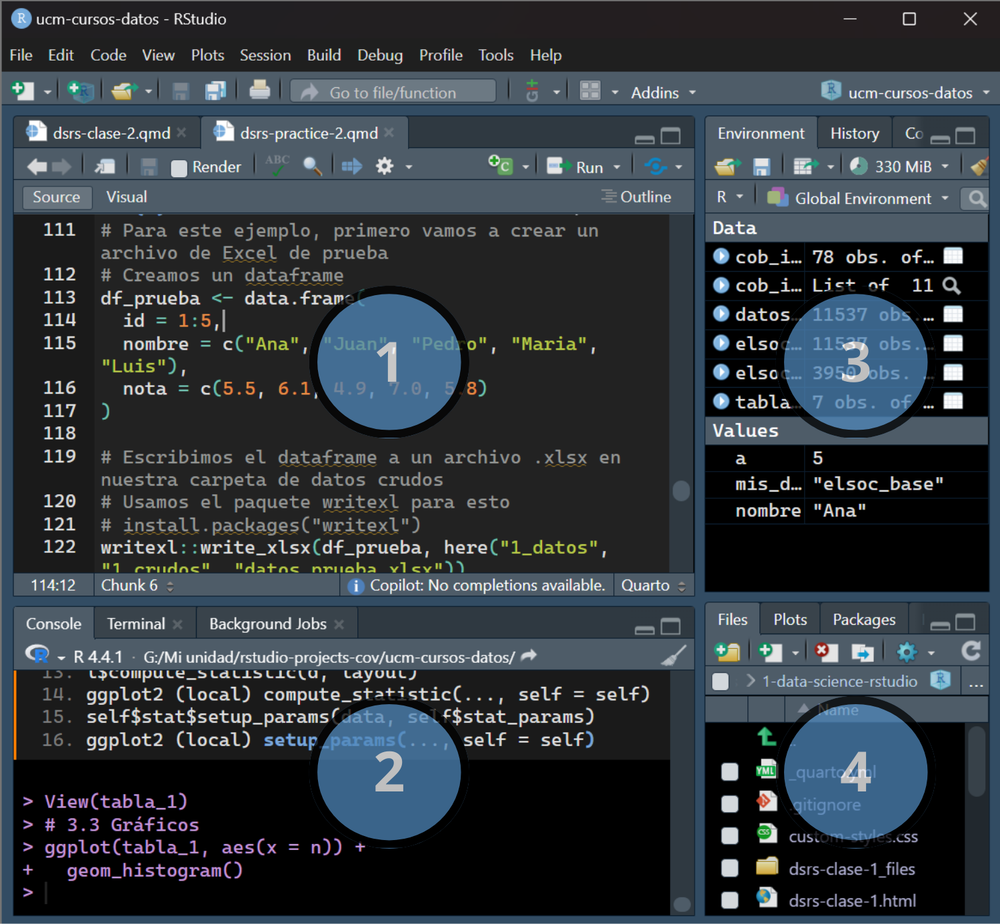
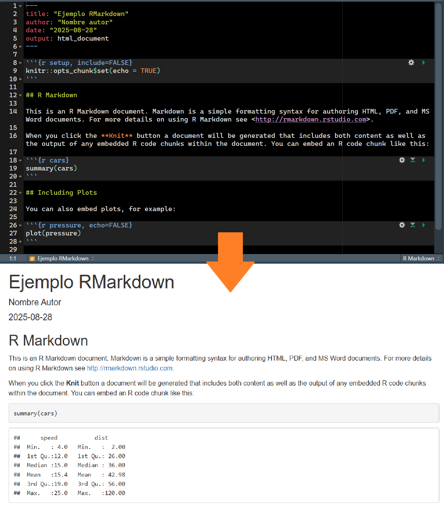

# Estructura de la sesión

1.  [Repaso y hoja de ruta](#repaso)
2.  [El entorno de RStudio](#entornor)
3.  [Conceptos básicos del lenguaje R](#conceptos)
4.  [Del script al reporte](#reporte)
5.  [Organización con RProjects](#rprojects)
6.  [Importación de datos](#import)
7.  [Resumen y próximos pasos](#resumen)

# 1. Repaso y hoja de ruta {#repaso}

## ¿Qué vimos en la sesión anterior?

-   **Introducción a la Ciencia de Datos:** Definimos qué es, su relevancia para la sociología y el flujo de trabajo de datos Tidyverse
-   **Presentación del curso:** Discutimos los objetivos de aprendizaje, la metodología y el sistema de evaluación.

## ¿Qué veremos hoy?

Hoy sentaremos las bases de **cómo** vamos a trabajar en este curso.

::: incremental
-   **Introducción a R y RStudio:** Un primer vistazo a la interfaz y la consola.
-   **Organización:** Aprenderemos a organizar nuestros análisis en proyectos autocontenidos.
-   **Flujo de trabajo:** Conoceremos el `tidyverse`, un ecosistema de paquetes que facilitan la ciencia de datos.
-   **Práctica:** Crearemos nuestro primer proyecto e importaremos nuestros primeros datos.
:::

# 2. El entorno de RStudio {#entornor}

## Anatomía de RStudio

RStudio está organizado en paneles. La configuración más común es:

::::: columns
::: {.column width="60%"}

::: incremental
1.  **Editor de Scripts (Arriba-Izquierda):** Aquí escribes tu código (`.R`, `.Rmd`, `.qmd`). Es tu "hoja en blanco".
2.  **Consola (Abajo-Izquierda):** Aquí es donde R ejecuta el código. Ves los resultados, errores y mensajes. Es el "motor" de R.

3.  **Entorno/Historial (Arriba-Derecha):**
    -   *Environment*: Muestra todos los objetos (datos, variables) que has creado en tu sesión.
    -   *History*: Guarda un registro de todos los comandos que has ejecutado.

4.  **Archivos/Gráficos/Paquetes (Abajo-Derecha):**
    -   *Files*: Navegador de archivos de tu proyecto.
    -   *Plots*: Donde aparecen las visualizaciones que creas.
    -   *Packages*: Lista de todos los paquetes instalados y cuáles están cargados.
    
:::
:::

::: {.column width="40%"}

{fig-align="right"}
:::
:::::

## Consola vs. Script

Una distinción crucial para un trabajo ordenado y reproducible:

::::: columns
::: {.column width="50%"}
**Consola ➡️** - **Interactiva y Efímera.** 

- Ideal para pruebas rápidas, cálculos sencillos o explorar un objeto. 
- Lo que escribes aquí se pierde cuando cierras RStudio (aunque queda en el historial). 
- **Uso:** Escritura de código directa y apretar Enter
:::

::: {.column width="50%"}
:::{.fragment}
**Script 📝** - **Permanente y Reproducible.** 

- Es un archivo de texto (`.R`) donde guardas tu análisis completo. 
- Es tu "receta": cualquiera puede tomar tu script y tus datos y obtener los mismos resultados. 
- **Uso:** Aquí guardas todo tu flujo de trabajo, código se ejectuta con Ctrl+Enter (en `.R`) Ctrl+Shift+Enter (en `.Rmd` o `.qmd`)
:::
:::
:::::

. . .

> **Regla de oro: Si es un código que podrías necesitar de nuevo, ¡escríbelo en un script!**

# 3. Conceptos básicos del lenguaje R {#conceptos}

## Objetos: los "sustantivos" de R

En R, todo es un **objeto**. Piensa en ellos como contenedores que guardan información. En este sentido, se dice que **R es un lenguaje de programación orientado a objetos**


```{r, eval=FALSE, echo=TRUE}
# 'a' es un objeto que contiene el número 5
a <- 5

# 'nombre' es un objeto que contiene el texto "Ana"
nombre <- "Ana"

# 'mis_datos' es un objeto (más complejo) que contiene un set de datos
mis_datos <- load("../0-datos/elsoc_base.RData")
```

::: incremental
- Le damos un nombre a un objeto usando el operador de asignación `<-` (atajo de teclado: Alt + -).
- Los nombres de objetos deben empezar con una letra y no pueden contener espacios.
- La convención en el Tidyverse es usar `snake_case` (nombres_separados_por_guion_bajo).
:::

## Funciones: los "verbos" de R

Las funciones hacen cosas. Toman uno o más objetos como entrada (llamados argumentos) y producen un resultado sobre ese objeto. Siempre se escriben con paréntesis al final: `nombre_funcion()`.

. . .

Estructura típica de una función

> completa: `funcion(argumento1 = valor1, argumento2 = valor2)`
> simplificada: `funcion(valor1, valor2)`

. . .

Algunas funciones
```{r}
#| echo: true
# La función `mean()` calcula el promedio de un vector
mean(x = c(1, 2, 3, 4, 5))

# La función `load()` lee un archivo y crea un data frame
# Su argumento principal es la ruta al archivo
load("../0-datos/elsoc_base.RData")
```
. . .

**Para saber qué hace una función y qué argumentos necesita, usa `?nombre_funcion` en la consola**

## Paquetes: las "cajas de herramientas"

Los paquetes (o librerías) son colecciones de funciones, datos y
documentación agrupados por un propósito común. 

- R viene con un set base (R base), pero su verdadero poder está en los miles de paquetes que la comunidad ha desarrollado.
- El `tidyverse` es una colección de paquetes diseñados para la ciencia de datos (`ggplot2`, `dplyr`, `readr`, etc.).

. . .

Para usar un paquete, debes:

- Instalarlo (una sola vez): `install.packages("nombre_del_paquete")` 
- Cargarlo (en cada sesión): `library(nombre_del_paquete)`

::: callout-warning
### Error común

- `install.packages()` el argumento va entre comillas
- `library()` el argumento **no** lleva comillas
:::

## Estructura del Script para Análisis {#estructura_script}

Un script de análisis bien estructurado es fácil de leer y reutilizar. Una estructura recomendada es la siguiente:

``` r
# =============================================================================
# 1. CARGAR LIBRERÍAS Y BASES DE DATOS
# =============================================================================

# 1.1 Cargar paquetes
library(tidyverse)
# ...otros paquetes

# 1.2 Cargar datos
load("../0-datos/elsoc_base.RData")

# =============================================================================
# 2. PROCESAMIENTO Y LIMPIEZA
# =============================================================================

# 2.1 Renombrar variables
datos_limpios <- elsoc_base %>%
  #     nombre_nuevo = nombre_antiguo
  rename(id_encuesta = idencuesta) %>% 
  dplyr::select(id_encuesta, ola) %>% 
  drop_na()

# 2.2 Recodificar valores
# ...

# =============================================================================
# 3. ANÁLISIS DE DATOS
# =============================================================================

# 3.1 Análisis descriptivo
summary(datos_limpios$ola)

# 3.2 Tablas
tabla_1 <- datos_limpios %>%
  count(ola)

# 3.3 Gráficos
ggplot(tabla_1, aes(x = n)) +
  geom_histogram()
```

# 4. De Scripts a Reportes: R Markdown y Quarto {#reportes}

## ¿Qué son R Markdown (`.Rmd`) y Quarto (`.qmd`)?

Son formatos de archivo que permiten combinar texto plano, código de R y los resultados (output) de ese código -como tablas y gráficos- en un único documento. Piensa en ellos como un "cuaderno de laboratorio digital". 🔬

::::: columns
::: {.column width="60%"}
**Componentes clave:**

1.  **Encabezado YAML:** Metadatos como el título, autor y tipo de salida (`html`, `pdf`, `docx`).
2.  **Texto en Markdown:** Texto plano con **marcas** de formato.
3.  **Chunks de Código:** Bloques de código R (` ```{r} `) que se ejecutan al "renderizar" el documento.

:::{.fragment}
**Flujo de trabajo:**

1. Escribes en `.Rmd` o `.qmd`.
2. Haces clic en "Render" (o "Knit").
3. R ejecuta el código y combina todo en un documento pulcro (HTML, PDF, Word, etc.).
4. El reporte **se regenere directamente desde el código**, evitando el flujo copy/paste.
:::
:::
::: {.column width="40%"}

:::
:::::

# 5. Organización con RProjects {#rprojects}

## Antes de definir un RProjects ¿Por qué no solo escribir scripts y analizar datos?

En sociología, la **reproducibilidad** y la **transparencia** son fundamentales. Un análisis de datos no es solo el resultado final, **sino un proceso**.

. . .

Un flujo de trabajo estandarizado nos ayuda a: 

- **Organizar** nuestros archivos (datos, código, reportes). 
- **Colaborar** con otros investigadores. 
- **Asegurar** que nuestros resultados puedan ser verificados por otros (**¡y por nuestro "yo" del futuro!**). 
- **Evitar** errores comunes, como las rutas de archivos locales (`C:/Users/Mi_Nombre/Documentos/...`).

## La solución: Orden y buenas prácticas

Un flujo de trabajo estructurado y consistente nos permite: 

- **Aislar dependencias:** Cada proyecto es un mundo autocontenido. 
- **Facilitar la portabilidad:** Compartir tu trabajo es tan simple como comprimir una carpeta. 
- **Automatizar tareas:** El orden facilita la creación de reportes y análisis automáticos. 
- **Colaborar eficazmente:** Todos en el equipo saben dónde encontrar cada cosa.

## ¿Qué es un RProject?

Un Proyecto de RStudio es la base de nuestro flujo de trabajo. Es un archivo (`.Rproj`) que "vive" en la carpeta principal de tu análisis y la convierte en el **directorio de trabajo** por defecto.

Al abrir un archivo `.Rproj`, RStudio automáticamente: 

1. Inicia una nueva sesión de R. 
2. Establece el **directorio de trabajo** en la carpeta donde se encuentra el `.Rproj`.

Esto significa que todas las rutas a nuestros archivos (datos, imágenes, etc.) serán **relativas** a la carpeta del proyecto.


::: {.fragment}
::: {style="text-align: center"}
**¡Adiós al `setwd()`!** Usar `RProjects` es la práctica recomendada y nos ahorra muchos dolores de cabeza.

{fig-align="center" width="15%"}
:::
:::

## Principales beneficios RProject

::: incremental
1. **Define el directorio de trabajo (Working Directory):** Al abrir un proyecto, RStudio automáticamente sabe que la
carpeta que lo contiene es el punto de partida. ¡Adiós `setwd()`! 
2. **Autocontenido y portable:** Todo lo que necesitas para tu análisis (datos, código, salidas) está en una única carpeta. Puedes moverla, compartirla o enviarla por correo, y funcionará en cualquier máquina con R y RStudio. 
3. **Integración con control de versiones (Git):** Facilita enormemente el seguimiento de cambios y la colaboración (lo veremos más adelante en el curso CSCC).
:::

## ¿Cómo crear un Proyecto?

1.  Ve a `File > New Project...`
2.  Selecciona `New Directory` para una carpeta nueva o
    `Existing Directory` si ya tienes una carpeta para tu análisis.
3.  Elige `New Project`.
4.  Dale un nombre descriptivo a tu proyecto (ej.
    `analisis_desercion_escolar`) y elige dónde guardarlo.
5.  ¡Listo! RStudio se reiniciará y estarás "dentro" del proyecto. Verás
    el nombre del proyecto en la esquina superior derecha.

## Estructura de carpetas sugerida

Una buena práctica es organizar los proyectos con una estructura de carpetas clara. Para este curso. Una estructura típica es:

```plaintext
mi_proyecto/
├── mi_proyecto.Rproj
├── 1_datos
│   ├── 1_crudos        (datos originales, nunca los modifiques)
│   └── 2_procesados    (datos limpios o transformados)
├── 2_codigo
│   ├── 01_procesamiento_datos.R
│   ├── 02_analisis_descriptivo.R
│   └── 03_modelos.R
├── 3_resultados
│   ├── tablas
│   └── graficos
└── 4_documentos        (reportes, artículos, etc.)
```

# 6. Importación de datos {#import}

## Formatos comunes en Ciencias Sociales

Los datos pueden venir en múltiples formatos. Los más comunes son: 

- **Archivos de texto plano:** 
  - `.csv` (Comma-Separated Values) 
  - `.txt` (Tab-delimited, etc.) 
- **Hojas de cálculo:** 
  - `.xlsx` o `.xls` (Microsoft Excel) 
- **Archivos de software estadístico:** 
  - `.sav` (SPSS) 
  - `.dta` (Stata) 

## Paquetes del Tidyverse para la importación

El **Tidyverse** ofrece paquetes especializados y optimizados para cada
tipo de dato.

| Paquete    | Función principal          | Formato de archivo         |
|------------|----------------------------|----------------------------|
| `{readr}`  | `read_csv()`               | `.csv` y otros texto plano |
| `{readxl}` | `read_excel()`             | `.xlsx`, `.xls`            |
| `{haven}`  | `read_sav()`, `read_dta()` | `.sav`, `.dta`, etc.       |

::: incremental
**Ventajas:** 

- Son mucho más rápidos que las funciones base de R. 
- Importan los datos como `tibbles`, un formato de data frame mejorado. 
- Gestionan mejor las diferencias entre sistemas operativos.
:::

# 7. Resumen y próximos pasos {#resumen}

## Resumen de la sesión

-   **Organización es clave:** Un flujo de trabajo basado en **Proyectos de RStudio** es fundamental para la reproducibilidad.
-   **Estructura de carpetas:** Adopta una estructura de directorios lógica (`datos`, `codigo`, `resultados`).
-   **Importación con Tidyverse:** Utiliza los paquetes `{readr}`, `{readxl}` y `{haven}` para cargar tus datos de manera eficiente y consistente.

## Próxima sesión

**Sesión III: Transformación de datos con `{dplyr}`**

-   Aprenderemos los "verbos" fundamentales para la manipulación de
    datos:
    -   `select()`: seleccionar columnas.
    -   `filter()`: filtrar filas.
    -   `mutate()`: crear o modificar columnas.
    -   `arrange()`: ordenar filas.
    -   `summarise()` y `group_by()`: resumir datos.

# ¡Gracias por la atención!

<!-- ========================== -->
<!-- BARRA SUPERIOR E INFERIOR -->
<!-- ========================== -->

```{=html}
<script>
document.addEventListener('DOMContentLoaded', function() {
  // Crear barra superior
  var sectionBar = document.createElement('div');
  sectionBar.id = 'section-bar';
  sectionBar.innerHTML = `
    <span id="current-section"></span>
    
  `;
  document.body.appendChild(sectionBar);

  // Crear barra inferior
  var footerBar = document.createElement('div');
  footerBar.id = 'footer-bar';
  footerBar.innerHTML = `
    <span id="footer-text">Cristóbal Ortiz Vilches | CC BY-NC 4.0 2026 – Ciencia de Datos Aplicada con RStudio</span>
    <span id="page-counter"></span>
  `;
  document.body.appendChild(footerBar);

  // Capturar secciones principales
  var sectionTitles = [];
  var allSlides = document.querySelectorAll('.reveal .slides section');
  allSlides.forEach(function(slide) {
    let title = slide.querySelector('h1');
    if (title) {
      sectionTitles.push({ title: title.innerText, slide: slide });
    }
  });

  function updateBar(event) {
    let currentSlide = event.currentSlide;
    let currentIndex = Reveal.getSlidePastCount(currentSlide);
    let totalSlides = Reveal.getTotalSlides();

    // Actualiza contador inferior
    document.getElementById('page-counter').innerText = (currentIndex + 1) + "/" + totalSlides;

    const sectionText = document.getElementById('current-section');

    // Oculta la barra en la primera y última diapositiva
    if (currentIndex === 0 || currentIndex === 1 || currentIndex === totalSlides - 1) {
      sectionText.style.visibility = 'hidden';
    } else {
      sectionText.style.visibility = 'visible';

      // Actualiza texto de la sección si corresponde
      for (let i = 0; i < sectionTitles.length; i++) {
        if (sectionTitles[i].slide === currentSlide || sectionTitles[i].slide.contains(currentSlide)) {
          sectionText.innerText = sectionTitles[i].title;
          return;
        }
      }

      // Si no hay coincidencia exacta, busca la sección más cercana anterior
      for (let i = sectionTitles.length - 1; i >= 0; i--) {
        if (Reveal.getSlidePastCount(sectionTitles[i].slide) <= currentIndex) {
          sectionText.innerText = sectionTitles[i].title;
          return;
        }
      }
    }
  }

  Reveal.on('slidechanged', updateBar);
  Reveal.on('ready', updateBar);
});
</script>
```
