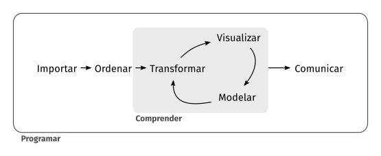

# Estructura de la sesión

1.  [Repaso y objetivos](#repaso)
2.  [Fundamentos: Tipos y Estructuras de Datos](#fundamentos)
3.  [**Módulo: Procesamiento de Datos**](#modulo)
    -   [Importación de datos](#importacion)
    -   [Limpieza y selección](#limpieza)
    -   [Ordenamiento y reestructuración](#ordenamiento)
4.  [Resumen y próximos pasos](#resumen)

# 1. Repaso y objetivos {#repaso}

## ¿Qué vimos en la sesión anterior?

-   **Entorno de RStudio:** Nos familiarizamos con los paneles (Script, Consola, Environment, Files/Plots).
-   **Conceptos básicos:** Aprendimos qué es un objeto, funciones y paquetes.
-   **Del script al reporte:** Identificamos las diferentes "hojas" que ofrece R para escribir código, texto o ambas.
-   **Flujo de trabajo:** Abordamos la importancia de los `RProjects` para la reproducibilidad y organización.
-   **Importación de datos:** Introdujimos brevemente los princpales formatos de bases de datos y cómo se importan.

## Objetivo de hoy

Hoy pasamos de los fundamentos a la práctica. El objetivo es:

> **Importar, limpiar y explorar bases de datos de distintas fuentes mediante funciones del `tidyverse`.**

Al final de esta sesión, serás capaz de tomar un set de datos "crudo" y darle una estructura básica para el análisis.

# 2. Fundamentos: Tipos y Estructuras de Datos {#fundamentos}

## Tipos de datos:

Los tipos de datos más comunes que encontraremos:

| Tipo        | Descripción                     | Ejemplo en R            |
|-------------|---------------------------------|-------------------------|
| `numeric`   | Números (decimales o enteros)   | `25`, `1.75`            |
| `character` | Texto (entre comillas)          | `"Santiago"`, `"Mujer"` |
| `logical`   | Verdadero o Falso               | `TRUE`, `FALSE`         |
| `factor`    | Variables categóricas ordenadas | `factor("Educ. Media")` |

-   Con la función `class()` puedo observar el tipo de dato

## Estructuras de datos:

Nos centraremos en dos estructuras clave:

-   **Vectores `c()`**: Una secuencia de datos **del mismo tipo**. Son las columnas de nuestras bases de datos.

```{r}
#| echo: true
#| eval: false
edades <- c(22, 45, 31, 56)
```

::: fragment
-   **Tibbles (Data Frames)**: ¡Nuestra principal estructura de trabajo! Una tabla donde las columnas son vectores.

```{r}
#| echo: true
#| eval: false
library(tidyverse)
mi_tibble <- tibble(edad = edades, comuna = c("A", "B", "C", "D"))
```
:::

# 3. Módulo: Procesamiento de Datos {#modulo}

## Preámbulo: conociciendo el paquete `tidyverse`

Como vimos en sesiones anteriores, `tidyverse` es una colección de paquetes diseñados para la ciencia de datos que comparten una filosofía y gramática común.

Al ejecutar `library(tidyverse)`, cargamos los paquetes más importantes, incluyendo:

-   `readr`, `haven`, `readxl`: Para **importar** datos.
-   `dplyr`: Para **manipular** y limpiar datos.
-   `tidyr`: Para **ordenar** y reestructurar datos.
-   `ggplot2`: Para **visualizar** datos (lo veremos más adelante).

::: fragment

:::

## Paso 1. Importación de datos {#importacion}

### El desafío: Múltiples formatos

-   En ciencias sociales, los datos provienen de diversas fuentes y formatos.
-   El `tidyverse` nos da funciones específicas y consistentes para cada uno.

### Paquetes para la importación

| Paquete  | Propósito                                       | Formatos comunes |
|---------------|------------------------------------------|---------------|
| `readr`  | Para archivos de texto plano (delimitados)      | `.csv`, `.tsv`   |
| `readxl` | Para hojas de cálculo de Microsoft Excel        | `.xls`, `.xlsx`  |
| `haven`  | Para formatos de software estadístico comercial | `.sav`, `.dta`   |

Estos paquetes ya vienen instalados y cargados con `library(tidyverse)`.

## Paso 1. Importación de datos

:::::: {.columns .incremental}
::: {.column width="33%"}
**Leyendo un archivo CSV con `readr`**

Los archivos `.csv` (valores separados por comas) son el formato más universal.

```{r}
#| echo: true
#| eval: false
library(readr)

# read_csv es inteligente y adivina el tipo de cada columna
datos_csv <- read_csv("ruta/a/mis_datos.csv")
```

**Ventaja de `readr`:** Es mucho más rápido y robusto que la función base `read.csv()`. No convierte texto en factores automáticamente.
:::

::: {.column width="33%"}
**Leyendo un archivo Excel con `readxl`**

El paquete `readxl` permite leer tanto `.xls` como `.xlsx` sin necesidad de tener Excel instalado.

```{r}
#| echo: true
#| eval: false
library(readxl)

# Por defecto lee la primera hoja
datos_excel <- read_excel("ruta/a/encuesta.xlsx")

# Podemos especificar la hoja por nombre o número
datos_hoja2 <- read_excel("ruta/a/encuesta.xlsx", sheet = "Hoja2")
```
:::

::: {.column width="33%"}
**Leyendo SPSS y STATA con `haven`**

El paquete `haven` es esencial para sociólogos, ya que permite importar datos conservando metadatos importantes como las etiquetas de valor y de variable.

```{r}
#| echo: true
#| eval: false
library(haven)

# Para leer un archivo de SPSS (.sav)
datos_spss <- read_sav("ruta/a/casen2022.sav")

# Para leer un archivo de STATA (.dta)
datos_stata <- read_dta("ruta/a/elsoc2021.dta")
```

Los datos importados con `haven` se cargan como `tibbles`, y las variables con etiquetas se marcan como tipo `<labelled>`.
:::
::::::

## Paso 2. Limpieza de datos: el paquete `dplyr` {#limpieza}

El paquete `dplyr` proporciona funciones simples que nos permiten resolver los problemas más comunes de manipulación de datos.

Las 5 funciones principales son:

::: incremental
-   `select()`: Elige columnas (variables).
-   `filter()`: Elige filas (observaciones) según una condición.
-   `arrange()`: Ordena las filas.
-   `mutate()`: Crea nuevas columnas.
-   `summarise()`: Colapsa múltiples valores a un resumen.
:::

::: fragment
Hoy nos enfocaremos en los tres primeros.
:::

## Paso 2. Limpieza de datos: seleccionando columnas con `select()`

Nos permite quedarnos solo con las variables que nos interesan.

```{r}
#| echo: true
#| eval: false
# Supongamos que datos_spss tiene 100 variables
# Seleccionamos solo las variables de interés
datos_limpios <- select(datos_spss, id_hogar, edad, sexo, region)
```

**Ayudas de `select()`:**

- `select(starts_with("pco"))`: Todas las variables que empiezan con "pco".
- `select(ends_with("_w1"))`: Todas las que terminan con "\_w1".
- `select(contains("educ"))`: Todas las que contienen "educ".
- `select(-año, -folio)`: Todas las variables **excepto** año y folio.
- `select(everything())`: Selecciona todas las variables

## Paso 2. Limpieza de datos: usos alternativos de `select()`

A veces `select()` nos ayuda a ordenarr las columnas:

```{r}
#| echo: true
#| eval: false
# Supongamos que datos_dta tiene 100 variables
# Seleccionamos solo las variables de interés y traemos la variable 'id_persona' más "adelante"
datos_limpios <- select(datos_dta, id_hogar, id_persona, everything())
```


## Paso 2. Limpieza de datos: el operador `pipe`: `|>`

Antes de continuar, necesitamos conocer al `|>` (o `%>%`). Este operador nos permite encadenar operaciones de forma legible.

> Se lee como "**Y LUEGO**".

**Sin pipe:** `print(head(datos_spss))` $\to$ se lee de adentro hacia afuera

**Con pipe:** $\to$ se lee de arriba hacia abajo de manera sucesiva

```{r}
#| echo: true
#| eval: false
datos_spss |> 
  head() |> # toma datos_spss Y LUEGO saca las primeras 6 filas
  print()  # Y LUEGO imprime el resultado 
```

## Paso 2. Limpieza de datos: el operador `pipe`: `|>`

Usaremos el `pipe` principalmente para nuestros flujos de limpieza. En RStudio se puede incluir con **Ctrl+Shift+M**

Por ejemplo


```{r}
#| echo: true
#| eval: false

# Sin pipe
datos_limpios <- select(datos_spss, id_hogar, edad, sexo, region)
datos_filtrado <- select(datos_limpios, edad == 30)

# Con pipe
datos_limpios <- datos_spss %>% 
  select(id_hogar, edad, sexo, region) %>% # -> dataframe 'datos_spss' viene de más arriba
  filter(edad == 30)                       # -> encadeno otra función siguiendo la misma lógica
```

## Paso 2. Limpieza de datos: filtrando filas con `filter()`

Nos permite quedarnos con las observaciones que cumplen una o más condiciones lógicas.

```{r}
#| echo: true
#| eval: false
# Flujo de trabajo:
datos_spss |> 
  select(edad, sexo, region) |> # 1. Seleccionamos variables
  filter(region == 7)           # 2. Y LUEGO filtramos por la Región Del Maule
```

## Paso 2. Limpieza de datos: filtrando filas con `filter()`

### Condiciones lógicas en `filter()`

| Operador | Significado                |
|----------|----------------------------|
| `==`     | Igual a                    |
| `!=`     | No igual a                 |
| `>`      | Mayor que                  |
| `<`      | Menor que                  |
| `>=`     | Mayor o igual que          |
| `<=`     | Menor o igual que          |
| `&`      | Y (ambas condiciones)      |
| `|`      | O (al menos una condición) |
| `%in%`   | Pertenece a un conjunto    |


### Ejemplo combinado de `filter()`

```{r}
#| echo: true
#| eval: false
# Objetivo: Mujeres, de 30 a 40 años, de las regiones V, VIII o IX.

datos_filtrados <- datos_spss |> 
  filter(
    sexo == 2,                  # Condición 1: sexo es mujer (supongamos 2)
    edad >= 30 & edad <= 40,    # Condición 2: edad entre 30 y 40
    region %in% c(5, 8, 9)      # Condición 3: región pertenece al conjunto
  )
```

## Paso 3. Ordenamiento y reestructuración {#ordenamiento}

### Ordenando filas con `arrange()`

Reordena las filas de nuestra tabla según los valores de una o más columnas.

```{r}
#| echo: true
#| eval: false
# Ordenar por edad, de menor a mayor
datos_spss |> 
  arrange(edad)

# Ordenar por edad, de mayor a menor
datos_spss |> 
  arrange(desc(edad))

# Ordenar por región y luego por edad
datos_spss |> 
  arrange(region, desc(edad))
```

# 4. Resumen y próximos pasos {#resumen}

## Resumen de la sesión

-   **Importación:** Aprendimos a leer datos desde múltiples formatos (`.csv`, `.xlsx`, `.sav`, `.dta`) usando los paquetes del `tidyverse`.
-   **Limpieza:** Introdujimos los verbos clave de `dplyr`:
    -   `select()` para elegir variables.
    -   `filter()` para elegir observaciones.
    -   El operador `|>` para encadenar todo.
-   **Ordenamiento:** Vimos cómo reordenar filas con `arrange()` y cómo reestructurar datos de formato ancho a largo con `pivot_longer()` de `tidyr`, además de unir tablas con `left_join()`.

------------------------------------------------------------------------

## Próximos pasos

En la próxima sesión, completaremos nuestra caja de herramientas de manipulación de datos con `dplyr`:

-   **Crearemos nuevas variables** con `mutate()`.
-   **Calcularemos resúmenes y agregados** con `summarise()` y `group_by()`.

¡Con eso, estaremos listos para empezar a visualizar y modelar!


# ¡Gracias por la atención!

<!-- ========================== -->
<!-- BARRA SUPERIOR E INFERIOR -->
<!-- ========================== -->

```{=html}
<script>
document.addEventListener('DOMContentLoaded', function() {
  // Crear barra superior
  var sectionBar = document.createElement('div');
  sectionBar.id = 'section-bar';
  sectionBar.innerHTML = `
    <span id="current-section"></span>
    
  `;
  document.body.appendChild(sectionBar);

  // Crear barra inferior
  var footerBar = document.createElement('div');
  footerBar.id = 'footer-bar';
  footerBar.innerHTML = `
    <span id="footer-text">Cristóbal Ortiz Vilches | CC BY-NC 4.0 2025 – Ciencia de Datos Aplicada con RStudio</span>
    <span id="page-counter"></span>
  `;
  document.body.appendChild(footerBar);

  // Capturar secciones principales
  var sectionTitles = [];
  var allSlides = document.querySelectorAll('.reveal .slides section');
  allSlides.forEach(function(slide) {
    let title = slide.querySelector('h1');
    if (title) {
      sectionTitles.push({ title: title.innerText, slide: slide });
    }
  });

  function updateBar(event) {
    let currentSlide = event.currentSlide;
    let currentIndex = Reveal.getSlidePastCount(currentSlide);
    let totalSlides = Reveal.getTotalSlides();

    // Actualiza contador inferior
    document.getElementById('page-counter').innerText = (currentIndex + 1) + "/" + totalSlides;

    const sectionText = document.getElementById('current-section');

    // Oculta la barra en la primera y última diapositiva
    if (currentIndex === 0 || currentIndex === 1 || currentIndex === totalSlides - 1) {
      sectionText.style.visibility = 'hidden';
    } else {
      sectionText.style.visibility = 'visible';

      // Actualiza texto de la sección si corresponde
      for (let i = 0; i < sectionTitles.length; i++) {
        if (sectionTitles[i].slide === currentSlide || sectionTitles[i].slide.contains(currentSlide)) {
          sectionText.innerText = sectionTitles[i].title;
          return;
        }
      }

      // Si no hay coincidencia exacta, busca la sección más cercana anterior
      for (let i = sectionTitles.length - 1; i >= 0; i--) {
        if (Reveal.getSlidePastCount(sectionTitles[i].slide) <= currentIndex) {
          sectionText.innerText = sectionTitles[i].title;
          return;
        }
      }
    }
  }

  Reveal.on('slidechanged', updateBar);
  Reveal.on('ready', updateBar);
});
</script>
```
