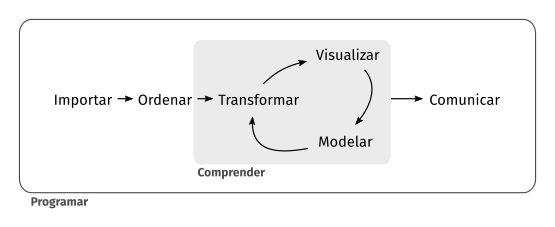

# Estructura de la sesión

1.  [Repaso y objetivos](#repaso)
2.  [**Módulo: Modificación y Resumen de Datos**](#modulo)
    -   [Creando y modificando variables](#mutate)
    -   [Recodificando datos con lógica](#recode)
    -   [Etiquetando datos para análisis](#labels)
    -   [Resumiendo datos](#summarise)
3.  [Resumen y próximos pasos](#resumen)

# 1. Repaso y objetivos {#repaso}

## ¿Qué vimos en la sesión anterior?

::: incremental
-   **Importación de datos**: Aprendimos a usar `readr`, `readxl` y `haven` para importar datos de diversos formatos.
-   **Limpieza de datos**: Nos enfocamos en `dplyr`, utilizando `select()` para elegir variables y `filter()` para elegir filas.
-   **Ordenamiento**: Usamos `arrange()` para ordenar las filas de nuestros datos.
-   **El operador `|>`**: Vimos cómo el `pipe` nos permite encadenar operaciones de forma legible.

:::

## Objetivo de hoy

Hoy completamos nuestra caja de herramientas de manipulación de datos con `dplyr` y otros paquetes del `tidyverse`. 

> **Modificar, recodificar y resumir bases de datos para preparar el análisis.**

Al final de esta sesión, podemos ir más allá de la limpieza básica para transformar tus datos en información lista para la visualización y el modelado.

::: fragment

:::


# 2. Módulo: Modificación y Resumen de Datos {#modulo}

## El desafío: Transformar variables

En la investigación social, rara vez trabajamos con datos 'listos'. Necesitamos transformarlos para que reflejen nuestras variables teóricas y operacionales.

::: incremental
-   **Crear nuevas variables**: A partir de las existentes, como un índice socioeconómico.
-   **Recodificar valores**: Unir categorías, cambiar `1` y `2` por `"Hombre"` y `"Mujer"`.
-   **Resumir datos**: Calcular promedios, medianas, conteos por grupo.
:::

## El paquete `dplyr`: los verbos que faltan

La sesión anterior vimos: `select()`, `filter()`, `arrange()`. Ahora nos centraremos en `mutate()` y `summarise()`.

::: fragment
-   `mutate()`: Crea o modifica variables.
-   `summarise()`: Colapsa múltiples valores a un resumen.
-   `group_by()`: Trabaja en conjunto con `summarise()` para agrupar los datos antes de resumir.
:::

## Paso 1. Creando y modificando variables con `mutate()` {#mutate}

`mutate()` es la función más importante para la creación de nuevas variables. Sigue la siguiente estructura:

> mutate(nuevo_nombre = antiguo_nombre "+" alguna_funcion + algun_operador)

Un ejemplo aplicado:
```{r}
#| echo: true
#| eval: true
#| warning: false

# Cargamos el tidyverse
library(tidyverse)

# Creamos un ejemplo de datos
datos <- tibble(
  nombre = c("Ana", "Juan", "Maria"),
  edad = c(25, 30, 28)
)

# Creamos una nueva variable 'edad_dias'
datos_modificados <- datos |> 
  mutate(edad_dias = edad * 365)

print(datos_modificados$edad_dias)
```

## `mutate()` y el `pipe`

`mutate()` se usa idealmente con el `pipe |>`.

```{r}
#| echo: true
#| eval: false

# Supongamos un dataframe llamado 'encuesta'
encuesta |>
  select(edad, educacion, ingreso) |> # Seleccionamos variables de interés
  mutate(
    ingreso_log = log(ingreso), # Creamos variable de ingreso en escala logaritmica
    edad_categoria = if_else(edad < 30, "Joven", "Adulto") # Recodificamos la edad
  )
```

## Funciones útiles dentro de `mutate()`

| Función | Descripción | Ejemplo |
|---|---|---|
| `log()` | Logaritmo natural | `mutate(log_ingreso = log(ingreso))` |
| `sqrt()`| Raíz cuadrada | `mutate(raza = sqrt(dist))` |
| `case_when()`| Lógica condicional compleja | `mutate(cat = case_when(...))` |
| `if_else()`| Lógica condicional simple | `mutate(cat = if_else(...))` |
| `as.character()`| Cambia a caracter | `mutate(id_char = as.character(id))` |
| `str_to_lower()`| Texto a minúsculas | `mutate(texto_l = str_to_lower(texto))` |
| `ymd()` | De texto a fecha | `mutate(fecha = ymd(fecha_texto))` |

## Paso 2. Recodificando variables con lógica {#recode}

A menudo, necesitamos recodificar valores. Aunque `car::recode()` es una opción, las funciones del `tidyverse` son más potentes y legibles en un flujo de trabajo encadenado.

### 2.1. `if_else()`: Si/Entonces/Sino

Ideal para condiciones simples.

  - `if_else(condición, valor_si_es_verdadero, valor_si_es_falso)`

<!-- end list -->

```{r}
#| echo: true
#| eval: false

datos |>
  mutate(
    # Recodificamos 'sexo' donde 1 = hombre y 2 = mujer
    sexo = if_else(sexo == 1, "Hombre", "Mujer")
  )
```

## 2.2. `case_when()`: Múltiples condiciones

La herramienta más poderosa para recodificar.

  - `case_when(condicion1 ~ valor1, condicion2 ~ valor2, ...)`
  - Funciona como una secuencia de `if/else if/else`.
  - La última condición, `TRUE ~ valor`, actúa como un `else`.

<!-- end list -->

```{r}
#| echo: true
#| eval: false

# Recodificamos la edad en categorías
encuesta_recodificada <- encuesta |> 
  mutate(
    rango_edad = case_when(
      edad <= 18 ~ "Menor de edad",
      edad > 18 & edad <= 30 ~ "Joven",
      edad > 30 & edad <= 60 ~ "Adulto",
      edad > 60 ~ "Adulto mayor"
    )
  )
```

## `case_when()` con valores perdidos (`NA`)

`case_when()` maneja los `NA` de forma explícita. Si no se incluye una condición, los valores que no coinciden se convierten en `NA`.

```{r}
#| echo: true
#| eval: false

# Recodificamos la variable 'educacion'
encuesta_recodificada_educacion <- encuesta |>
  mutate(
    nivel_educ = case_when(
      educacion %in% c(1, 2) ~ "Básica",
      educacion == 3 ~ "Media",
      educacion == 4 ~ "Superior",
      is.na(educacion) ~ "No responde" # Manejo explícito de NA
    )
  )
```

## 2.3. Recodificando factores con `forcats`

El paquete `forcats` (parte de `tidyverse`) está diseñado para trabajar con variables categóricas.

### `fct_recode()`: Recodificación de etiquetas

Permite cambiar las etiquetas de un factor de forma intuitiva.

```{r}
#| echo: true
#| eval: false

library(forcats)

# Recodificamos 'nivel_educ' para agrupar 'Básica' y 'Media'
datos_recod <- encuesta_recodificada |> 
  mutate(
    nivel_educ_agrupado = fct_recode(
      factor(nivel_educ),
      "Educación pre-superior" = "Básica",
      "Educación pre-superior" = "Media"
    )
  )
```

## Paso 3. Etiquetando datos con `sjlabelled` {#labels}

En R, los datos importados de SPSS o Stata a menudo tienen etiquetas de valor y variable (`<labelled>`). 

  - `sjlabelled` es un paquete que nos permite manejar y crear estas etiquetas.

### `set_labels()`: Agregando etiquetas a un vector

```{r}
#| echo: true
#| eval: false

library(sjlabelled)

# Creamos un vector de 1 y 2
sexo_numerico <- c(1, 2, 1, 2, 1)

# Agregamos etiquetas
sexo_etiquetado <- set_labels(
  x = sexo_numerico,
  labels = c("Hombre" = 1, "Mujer" = 2)
)

# Ahora el vector tiene etiquetas asociadas
# > sexo_etiquetado
# [1] 1 2 1 2 1
# attr(,"labels")
# Hombre  Mujer 
#      1      2 
```

## Paso 4. Resumiendo datos: `group_by()` y `summarise()` {#summarise}

`summarise()` colapsa las filas de un dataframe a un resumen de una sola fila.

```{r}
#| echo: true
#| eval: false

# Calculamos el promedio de edad de toda la encuesta
encuesta |> 
  summarise(promedio_edad = mean(edad, na.rm = TRUE))
```

El verdadero poder viene al combinarlo con `group_by()`.

## `group_by()`: Trabajar por grupos

`group_by()` no cambia los datos, sino que agrega una instrucción: "las siguientes operaciones se aplicarán a cada grupo por separado".

```{r}
#| echo: true
#| eval: false

# ¿Cuál es el promedio de edad por sexo?
encuesta |> 
  group_by(sexo) |> # Agrupamos por sexo
  summarise(
    promedio_edad = mean(edad, na.rm = TRUE) # Calculamos el promedio para cada sexo
  )
```

## Funciones útiles dentro de `summarise()`

| Función | Descripción |
|---|---|
| `mean()` | Promedio |
| `median()` | Mediana |
| `sd()` | Desviación estándar |
| `min()` | Mínimo |
| `max()` | Máximo |
| `n()` | Conteo de observaciones en el grupo |
| `n_distinct()` | Conteo de valores únicos |

## Ejemplo completo con `group_by()` y `summarise()`

```{r}
#| echo: true
#| eval: false

# Objetivo: Calcular el promedio de ingreso por rango de edad y región
encuesta |> 
  mutate(
    rango_edad = case_when(
      edad <= 30 ~ "18-30 años",
      edad > 30 & edad <= 60 ~ "31-60 años",
      edad > 60 ~ "60+ años"
    )
  ) |>
  group_by(region, rango_edad) |> 
  summarise(
    ingreso_promedio = mean(ingreso, na.rm = TRUE),
    n_observaciones = n() # Conteo de personas por grupo
  ) |> 
  ungroup() # Es una buena práctica desagrupar al final
```

## Resumiendo con `count()`

`count()` es una función conveniente que combina `group_by()` y `summarise()` para contar observaciones.

```{r}
#| echo: true
#| eval: false

# Contar cuántas personas hay por región
encuesta |>
  count(region)

# Equivalente a:
encuesta |>
  group_by(region) |>
  summarise(n = n())
```

# 3. Resumen y próximos pasos {#resumen}

## Resumen de la sesión

::: incremental

  - **Transformación**: Vimos cómo crear y modificar variables usando `mutate()`.
  - **Recodificación**: Aprendimos a usar `if_else()` para lógica simple y `case_when()` para condiciones complejas.
  - **Agregación**: Exploramos el poder de `summarise()` para crear resúmenes y de `group_by()` para hacerlo por grupos.
  - **Utilidad sociológica**: Estas funciones son cruciales para operacionalizar conceptos, crear índices, y analizar patrones agregados en nuestros datos.

:::

## Próximos pasos

En la próxima sesión, estaremos listos para **visualizar** nuestros datos.

  - Exploraremos el paquete **`ggplot2`**, la gramática de los gráficos de R.
  - Aprenderemos a construir gráficos univariados y bivariados (histogramas, barras, dispersión, etc.).

# ¡Gracias por la atención!

```{=html}
<script>
document.addEventListener('DOMContentLoaded', function() {
  // Crear barra superior
  var sectionBar = document.createElement('div');
  sectionBar.id = 'section-bar';
  sectionBar.innerHTML = `
    <span id="current-section"></span>
    
  `;
  document.body.appendChild(sectionBar);

  // Crear barra inferior
  var footerBar = document.createElement('div');
  footerBar.id = 'footer-bar';
  footerBar.innerHTML = `
    <span id="footer-text">Cristóbal Ortiz Vilches | CC BY-NC 4.0 2026 – Ciencia de Datos Aplicada con RStudio</span>
    <span id="page-counter"></span>
  `;
  document.body.appendChild(footerBar);

  // Capturar secciones principales
  var sectionTitles = [];
  var allSlides = document.querySelectorAll('.reveal .slides section');
  allSlides.forEach(function(slide) {
    let title = slide.querySelector('h1');
    if (title) {
      sectionTitles.push({ title: title.innerText, slide: slide });
    }
  });

  function updateBar(event) {
    let currentSlide = event.currentSlide;
    let currentIndex = Reveal.getSlidePastCount(currentSlide);
    let totalSlides = Reveal.getTotalSlides();

    // Actualiza contador inferior
    document.getElementById('page-counter').innerText = (currentIndex + 1) + "/" + totalSlides;

    const sectionText = document.getElementById('current-section');

    // Oculta la barra en la primera y última diapositiva
    if (currentIndex === 0 || currentIndex === 1 || currentIndex === totalSlides - 1) {
      sectionText.style.visibility = 'hidden';
    } else {
      sectionText.style.visibility = 'visible';

      // Actualiza texto de la sección si corresponde
      for (let i = 0; i < sectionTitles.length; i++) {
        if (sectionTitles[i].slide === currentSlide || sectionTitles[i].slide.contains(currentSlide)) {
          sectionText.innerText = sectionTitles[i].title;
          return;
        }
      }

      // Si no hay coincidencia exacta, busca la sección más cercana anterior
      for (let i = sectionTitles.length - 1; i >= 0; i--) {
        if (Reveal.getSlidePastCount(sectionTitles[i].slide) <= currentIndex) {
          sectionText.innerText = sectionTitles[i].title;
          return;
        }
      }
    }
  }

  Reveal.on('slidechanged', updateBar);
  Reveal.on('ready', updateBar);
});
</script>
```
