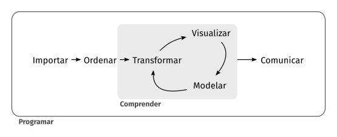
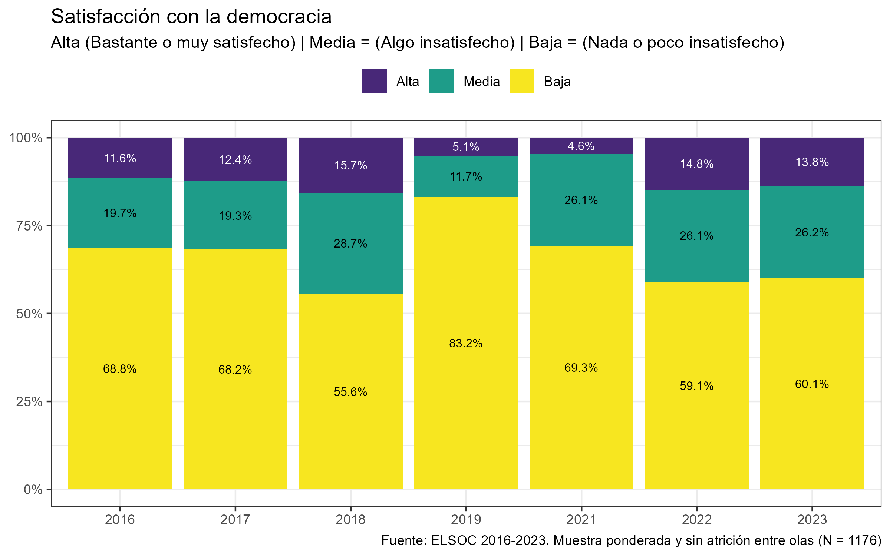
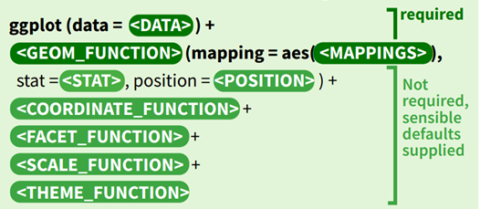

# Estructura de la sesión

1.  [Repaso y objetivos](#repaso)
2.  [**Módulo: La Gramática de los Gráficos**](#modulo)
    -   [¿Qué es `ggplot2`?](#intro-ggplot)
    -   [Las capas de un gráfico](#capas)
    -   [Gráficos univariados](#univariados)
    -   [Gráficos bivariados](#bivariados)
3.  [Resumen y próximos pasos](#resumen)

# 1. Repaso y objetivos {#repaso}

## ¿Qué vimos en la sesión anterior?

::: incremental
-   **Transformación de datos**: Usamos `mutate()` para crear y
    modificar variables.
-   **Lógica condicional**: Aprendimos a recodificar con `if_else()`,
    `case_when() y otras funciones`.
-   **Resumen de datos**: Vimos el poder de `group_by()` y `summarise()`
    para agregar datos y calcular estadísticas.
-   **Conteo**: Utilizamos `count()` como un atajo para contar
    observaciones por grupo.
:::

## Objetivo de hoy

Hoy damos el salto de la manipulación a la comunicación visual.
Empezamos a explorar una de las herramientas más potentes del
`tidyverse`: `ggplot2`.

> **Construir gráficos univariados y bivariados efectivos para la
> representación visual de datos.**

Al final de esta sesión, seremos capaces de traducir nuestras tablas y
resúmenes de datos en visualizaciones claras e informativas.

::: fragment

:::

# 2. Módulo: La Gramática de los Gráficos {#modulo}

## ¿Qué es la visualización de datos?

> *“En términos simples, se trata de gráficos y el acto de seleccionar
> el gráfico correcto para mostrar las características de los datos que
> se cree que son más relevantes”* (Kirk, 2018, p.17).

::: fragment
Según Kirk (2018), sus fases son:

1.  **Formula tu plan de trabajo**: planifica, define e inicia tu
    proyecto.
2.  **Trabajando con la base de datos**: produce, maneja y prepara tus
    datos.
3.  **Establece tu pensamiento editorial**: define qué le mostrarás a tu
    audiencia.
4.  **Desarrollar la solución de diseño**: crear un gráfico mediante un
    software.
:::

## ¿Por qué visualizar datos? {#intro-ggplot}

En ciencias sociales, un gráfico bien hecho puede revelar patrones,
tendencias y relaciones que una tabla de números no muestra con tanta
claridad.

::: incremental
-   **Exploración**: Nos ayuda a entender la distribución de nuestras
    variables.
-   **Comunicación**: Es una forma efectiva de presentar nuestros
    hallazgos a distintas audiencias.
-   **Diagnóstico**: Permite identificar valores atípicos (outliers) o
    problemas en los datos.
:::

## Ventajas y desventajas de los gráficos

### Ventajas

::: incremental
-   Facilita el **entendimiento** de los datos, lo cual fomenta abrir la
    ciencia.
-   Tiene la capacidad de **resumir** datos, mostrando los elementos más
    relevantes.
-   Es **atractivo** y capta mejor la atención de los y las lectoras.
:::

::: fragment
### Desventajas

-   Limitaciones visuales a medida que crece la cantidad de variables
    que quiero representar
:::

## El paquete `ggplot2`

`ggplot2` es la implementación en R de la **"Gramática de los
Gráficos"**. En lugar de pensar en tipos de gráficos (barras, puntos,
etc.), pensamos en sus **componentes**.

> Todo gráfico es un mapeo de los **datos** a **atributos estéticos**
> (color, forma, tamaño) de **objetos geométricos** (puntos, líneas,
> barras).

## 



## Las 3 capas esenciales de un gráfico {#capas}

::::: columns
::: {.column width="60%"}

Todo gráfico que hagamos tendrá al menos estas tres partes, unidas por
el signo `+`:

::: incremental

1.  `ggplot(data = <DATOS>)`: El lienzo inicial donde especificamos
    nuestro set de datos.
2.  `aes(...)`: Las **estéticas** (*aesthetics*), donde mapeamos las
    variables de nuestros datos a los ejes (x, y), colores, tamaños,
    etc.
3.  `geom_<...>()`: Las **geometrías**, que definen la forma que tomarán
    los datos en el gráfico (puntos, barras, líneas, etc.).
:::

::: fragment
```{r}
#| echo: true
#| eval: false

# Estructura básica de un gráfico en ggplot2
ggplot(data = mis_datos, mapping = aes(x = variable_x, y = variable_y)) +
  geom_point() # Geometría de puntos (gráfico de dispersión)
```
:::

:::

::: {.column width="40%"}



:::
:::::

# 2.1. Gráficos Univariados {#univariados}

Sirven para analizar una sola variable a la vez. Son el primer paso en
cualquier análisis exploratorio.

## Histograma:

`geom_histogram()` es ideal para visualizar la distribución de una
variable numérica continua.

```{r}
#| output-location: column
#| column: page
#| echo: true
#| warning: false
#| message: false
#| fig-height: 5
#| fig-asp: 0.618

library(tidyverse)
# Usaremos el dataset 'diamonds' que viene incluido en ggplot2
datos_diamantes <- diamonds

# Histograma del precio de los diamantes
ggplot(data = datos_diamantes, mapping = aes(x = price)) +
  geom_histogram(binwidth = 500, fill = "skyblue", color = "black") +
  labs(title = "Distribución del precio de los diamantes",
       x = "Precio (USD)",
       y = "Frecuencia")
```

## Gráfico de barras:

`geom_bar()` es perfecto para visualizar la frecuencia de una variable
categórica.

```{r}
#| output-location: column
#| column: page
#| echo: true
#| warning: false
#| message: false
#| fig-height: 5
#| fig-asp: 0.618

# Gráfico de barras de la calidad del corte de los diamantes
ggplot(data = datos_diamantes, mapping = aes(x = cut)) +
  geom_bar(fill = "steelblue") +
  labs(title = "Frecuencia por calidad de corte",
       x = "Calidad del corte",
       y = "Cantidad")
```

## Conectando dplyr con ggplot2

¿Y si queremos graficar un resumen que nosotros creamos? ¡Usamos el pipe
\|\>!

```{r}
#| output-location: column
#| column: page
#| echo: true
#| eval: false
#| fig-height: 5
#| fig-asp: 0.618

# 1. Calculamos el número de diamantes por claridad
# 2. Lo pasamos directamente a ggplot

datos_diamantes |> 
  count(clarity) |> # Usamos count() de la sesión pasada
  ggplot(mapping = aes(x = clarity, y = n)) + # <- OJO, cuando comienza ggplot se "encadena" con un +
  geom_col() # Usamos geom_col() cuando ya tenemos el valor de 'y' calculado
```

Si bien pipe se puede encadenar con ggplot, desde la función ggplot
hacia abajo se comienzan a agregar capas con un signo `+`.

# 2.2. Gráficos Bivariados {#bivariados}

Nos permiten explorar la relación entre dos variables.

## Gráfico de dispersión (scatter plot)

`geom_point()` Es la mejor opción para visualizar la relación entre dos
variables numéricas. Se suele utilizar con `geom_smooth`

```{r}
#| output-location: column
#| column: page
#| echo: true
#| warning: false
#| message: false
#| fig-height: 5
#| fig-asp: 0.618

# Relación entre quilates (carat) y precio (price)
ggplot(data = datos_diamantes, mapping = aes(x = carat, y = price)) +
  geom_point(alpha = 0.1) + # alpha regula la transparencia
  geom_smooth(method = "lm") + # 
  labs(title = "Relación entre quilates y precio",
       x = "Quilates (Carat)",
       y = "Precio (USD)")
```

## Gráfico de cajas (box plot):

Este tipo de gráfico es excelente para comparar la distribución de una
variable numérica a través de diferentes categorías. Se activa con
`geom_boxplot()`.

```{r}
#| output-location: column
#| column: page
#| echo: true
#| warning: false
#| message: false
#| fig-height: 5
#| fig-asp: 0.618

# Distribución del precio según la calidad del corte
ggplot(data = datos_diamantes, mapping = aes(x = cut, y = price)) +
  geom_boxplot(fill = "lightgreen") +
  labs(title = "Distribución del precio por calidad de corte",
       x = "Calidad del corte",
       y = "Precio (USD)")
```

## Agregando una tercera variable

Podemos mapear una tercera variable a estéticas como color, shape
(forma) o size (tamaño).

```{r}
#| output-location: column
#| column: page
#| echo: true
#| warning: false
#| message: false
#| fig-height: 5
#| fig-asp: 0.618


# Relación entre quilates y precio, coloreando por claridad (clarity)
ggplot(data = datos_diamantes, mapping = aes(x = carat, y = price, color = clarity)) +
  geom_point(alpha = 0.5) +
  labs(title = "Relación quilates-precio por claridad",
       x = "Quilates (Carat)",
       y = "Precio (USD)",
       color = "Claridad") # Modifica el título de la leyenda
```

# 3. Resumen y próximos pasos {#resumen}

## Resumen de la sesión

::: incremental
-   Gramática de los Gráficos: Aprendimos que un gráfico se compone de
    datos, estéticas y geometrías.

-   Capas: Vimos que la estructura básica de un gráfico en ggplot2 es
    ggplot() + geom\_\<...\>().

-   Gráficos Univariados: Creamos histogramas (geom_histogram) y
    gráficos de barras (geom_bar).

-   Gráficos Bivariados: Exploramos relaciones con gráficos de
    dispersión (geom_point) y boxplots (geom_boxplot).

-   Flujo de trabajo: Integramos dplyr y ggplot2 usando el pipe \|\>
    para visualizar datos ya procesados.
:::

## Proximos pasos

En la siguiente sesión volveremos al data wrangling, abordando tópicos
avanzados que permiten una visualización más optima.

-   **Manejo de datos faltantes**: identificar, gestionar e imputar
    datos faltantes aplicando métodos consistentes con el enfoque
    tidyverse.

-   **Union de bases de datos**: reconocer y unir bases de datos en base
    a elementos comunes.

# ¡Gracias por la atención!

<!-- ========================== -->

<!-- BARRA SUPERIOR E INFERIOR -->

<!-- ========================== -->

```{=html}
<script>
document.addEventListener('DOMContentLoaded', function() {
  // Crear barra superior
  var sectionBar = document.createElement('div');
  sectionBar.id = 'section-bar';
  sectionBar.innerHTML = `
    <span id="current-section"></span>
    
  `;
  document.body.appendChild(sectionBar);

  // Crear barra inferior
  var footerBar = document.createElement('div');
  footerBar.id = 'footer-bar';
  footerBar.innerHTML = `
    <span id="footer-text">Cristóbal Ortiz Vilches | CC BY-NC 4.0 2026 – Ciencia de Datos Aplicada con RStudio</span>
    <span id="page-counter"></span>
  `;
  document.body.appendChild(footerBar);

  // Capturar secciones principales
  var sectionTitles = [];
  var allSlides = document.querySelectorAll('.reveal .slides section');
  allSlides.forEach(function(slide) {
    let title = slide.querySelector('h1');
    if (title) {
      sectionTitles.push({ title: title.innerText, slide: slide });
    }
  });

  function updateBar(event) {
    let currentSlide = event.currentSlide;
    let currentIndex = Reveal.getSlidePastCount(currentSlide);
    let totalSlides = Reveal.getTotalSlides();

    // Actualiza contador inferior
    document.getElementById('page-counter').innerText = (currentIndex + 1) + "/" + totalSlides;

    const sectionText = document.getElementById('current-section');

    // Oculta la barra en la primera y última diapositiva
    if (currentIndex === 0 || currentIndex === 1 || currentIndex === totalSlides - 1) {
      sectionText.style.visibility = 'hidden';
    } else {
      sectionText.style.visibility = 'visible';

      // Actualiza texto de la sección si corresponde
      for (let i = 0; i < sectionTitles.length; i++) {
        if (sectionTitles[i].slide === currentSlide || sectionTitles[i].slide.contains(currentSlide)) {
          sectionText.innerText = sectionTitles[i].title;
          return;
        }
      }

      // Si no hay coincidencia exacta, busca la sección más cercana anterior
      for (let i = sectionTitles.length - 1; i >= 0; i--) {
        if (Reveal.getSlidePastCount(sectionTitles[i].slide) <= currentIndex) {
          sectionText.innerText = sectionTitles[i].title;
          return;
        }
      }
    }
  }

  Reveal.on('slidechanged', updateBar);
  Reveal.on('ready', updateBar);
});
</script>
```
