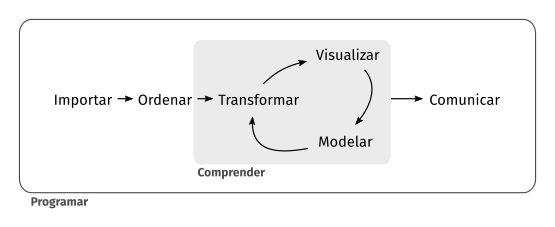

# Estructura de la sesión

1.  [Repaso y objetivos](#repaso)
2.  [Manejo de Datos Faltantes (`NA`)](#na)
3.  [Uniendo bases de datos: los `joins`](#joins)
4.  [Transformando datos: de Ancho a Largo](#pivot)
5.  [Aplicación práctica integrada](#aplicacion)
6.  [Resumen y próximos pasos](#resumen)

# 1. Repaso y objetivos {#repaso}

## ¿Qué vimos en la sesión anterior?

-   **Modificación de variables**: Usamos `select()`, `filter()` y
    `mutate()` para procesar nuestra base de datos
-   **Resumen de datos**: Agregamos datos con `group_by()` y
    `summarise()`.
-   **Introducción a ggplot2**: Con las herramientas de procesamiento,
    introdujimos el concepto de visualización con el paquete `{ggplot2}`

## Objetivos de hoy

Hoy abordaremos tres tareas avanzadas en la preparación de datos:

::: incremental
1.  **Gestionar datos ausentes (`NA`)**: Identificar, contar y decidir
    qué hacer con los valores perdidos.
2.  **Combinar múltiples fuentes de datos**: Aprender a unir datos de
    diferentes fuentes usando los distintos tipos de `joins`.
3.  **Reestructurar datos longitudinales**: Transformar datos entre
    formatos "ancho" y "largo" con `pivot_longer()` y `pivot_wider()`.
:::

::: fragment

:::

# 2. Manejo de Datos Faltantes (`NA`) {#na}

## ¿Qué es `NA` y por qué importa?

En R, `NA` (Not Available) representa la ausencia de un valor.

-   No es cero,
-   no es un espacio en blanco,
-   es la declaración de que **"no sabemos"** cuál es el dato.

**¿Por qué es importante?**

::: incremental
-   Casi todas las bases de datos del mundo real tienen valores
    faltantes.
-   Las operaciones matemáticas con `NA` suelen resultar en `NA` (ej.
    `5 + NA` es `NA`).
-   Ignorarlos puede sesgar nuestros análisis o romper nuestro código.
:::

## Manejo de `NA`

Principales herramientas:

::: incremental
1.  **Identificar**: La función `is.na()` nos devuelve `TRUE` si un
    valor es `NA`.
2.  **Contar**: Podemos combinar `is.na()` con `sum()` para contar
    cuántos `NA` hay en una variable.
3.  **Eliminar**:
    -   `na.omit()`: Elimina cualquier fila que contenga al menos un
        `NA`. Pero cuidado, puede eliminar demasiados datos.
    -   `drop_na()` de `tidyr`: Una versión más controlada que permite
        especificar en qué columnas buscar `NA`.
4.  **Ignorar en cálculos**: Muchas funciones (como `mean()`, `sum()`,
    `sd()`) tienen un argumento `na.rm = TRUE` para remover los `NA`
    antes de calcular.
:::

::: fragment
```{r, echo=TRUE, eval=FALSE}
library(tidyverse)

# Contar NAs en una columna específica
sum(is.na(datos$mi_columna))

# Eliminar filas con NAs en CUALQUIER columna
datos_limpios <- drop_na(datos)

# Calcular el promedio ignorando los NAs
mean(datos$mi_columna, na.rm = TRUE)
```
:::

# 3. Uniendo bases de datos: los joins {#joins}

## ¿Por qué unir datos?

Es muy raro que toda la información que necesitamos esté en una única
base de datos. Lo común es tener:

::: incremental
-   Una base con datos demográficos de encuestados.
-   Otra base con sus respuestas a una encuesta.
-   Quizás una tercera base con datos de su comuna.
:::

::: fragment
Para analizarlos juntos, necesitamos unirlos. Las funciones `_join()` de
`{dplyr}` lo hacen posible, siempre que tengamos una **llave** (una o
más columnas en común).
:::

## Tipos de uniones

Imaginemos que tenemos dos tablas, x (izquierda) e y (derecha).

::: incremental
-   `inner_join(x, y)`: Mantiene solo las filas que tienen una llave
    coincidente en ambas tablas.

-   `left_join(x, y)`: Mantiene todas las filas de la tabla x
    (izquierda) y agrega los datos de y donde las llaves coinciden. Si
    no hay coincidencia, se rellena con NA. ¡Es el más usado!

-   `right_join(x, y)`: Lo contrario. Mantiene todas las filas de y
    (derecha).

-   `full_join(x, y)`: Mantiene todas las filas de ambas tablas. Rellena
    con NA donde no hay coincidencias.
:::

::: fragment
Sintaxis de un join

```{r}
#| eval: false
#| echo: true

# El join más común:
datos_unidos <- left_join(
  tabla_izquierda,
  tabla_derecha,
  by = "id_columna" # Nombre de la columna que sirve como llave
)

# Si las columnas llave tienen nombres diferentes:
left_join(tabla_a, tabla_b, by = c("id_a" = "id_b"))
```
:::

# 4. Transformando datos: de Ancho a Largo {#pivot}

## ¿Por qué son importantes?

En sociología, no solo nos interesa una "foto" del momento, sino también
entender cómo cambian los fenómenos sociales a lo largo del tiempo.

-   **Trayectorias laborales**: ¿Cómo evoluciona el ingreso de una
    persona tras titularse?
-   **Opinión pública**: ¿Ha cambiado el apoyo a una política pública a
    lo largo de una década?
-   **Salud y bienestar**: ¿Cómo varía la percepción de bienestar en
    diferentes etapas de la vida?

Los **datos longitudinales** o de **panel** siguen a las mismas unidades
de análisis (personas, hogares, países) a través de múltiples momentos
en el tiempo.

## Datos longitudinales y su estructura

Cuando tenemos más de una medición en el tiempo, podemos estructurar los
datos de dos formas:

::: fragment
-   Formato Ancho (Wide): Cada punto en el tiempo es una columna.
    Intuitivo, pero malo para analizar.

    | id  | ingreso_2020 | ingreso_2021 |
    |-----|--------------|--------------|
    | 1   | 500          | 550          |
    | 2   | 1000         | 900          |
:::

::: fragment
-   Formato Largo (Long): Cada punto en el tiempo es una fila. Ideal
    para el análisis y la visualización con tidyverse.

    | id  | año  | ingreso |
    |-----|------|---------|
    | 1   | 2020 | 500     |
    | 1   | 2021 | 550     |
    | 2   | 2020 | 1000    |
    | 2   | 2021 | 900     |
:::

## Ventajas y desventajas

### Formato Ancho (Wide)

-   **Características**: Cada fila es una observación única (ej. una
    persona) y las mediciones repetidas en el tiempo se almacenan en
    columnas separadas.
-   **Ventajas**: Intuitivo para la entrada de datos y fácil de leer
    para pocas mediciones.
-   **Desventajas**: Difícil de analizar. ¿Cómo calculamos el ingreso
    promedio *por año*? ¿Cómo graficamos la evolución del ingreso? Se
    vuelve inmanejable con muchos puntos de tiempo.

### Formato Largo (Long)

-   **Características**: Cada fila es una observación en *un punto del
    tiempo*. Hay columnas que identifican la unidad de análisis
    (`id_persona`), el tiempo (`año`) y el valor observado (`ingreso`).
-   **Ventajas**: Es el formato "tidy" o limpio para el análisis.
    Facilita el uso de `group_by()`, `ggplot()` y modelos estadísticos.
-   **Desventajas**: Puede ser menos intuitivo de leer al principio, ya
    que hay múltiples filas para la misma persona.

## ¿Cómo hacerlo en R?

En R usaremos dos funciones clave del paquete `{tidyr}`.

::: incremental
-   `pivot_longer()`: "Alarga" los datos. Toma múltiples columnas y las
    colapsa en un par de columnas de "nombre" y "valor".

-   `pivot_wider()`: "Ensancha" los datos. Es la operación inversa, útil
    para reportes o tablas de resumen.
:::

## De ancho a largo

```{r}
#| eval: false
#| echo: true

# En general

datos_long <- datos_wide |>
  pivot_longer(
    cols = c(columna1, columna2, columna3), # Las columnas que queremos alargar
    names_to = "nueva_columna_nombres",     # Nombre de la nueva columna para las llaves
    values_to = "nueva_columna_valores"     # Nombre de la nueva columna para los valores
  )

# En nuestro ejemplo
datos_long <- datos_wide %>%  
  pivot_longer(cols = starts_with("ingreso_"), 
               names_to = "año", 
               values_to = "ingreso") 
```

## De largo a ancho

# 5. Resumen y próximos pasos {#resumen}

Resumen de la sesión

::: incremental
-   Datos Faltantes (NA): Aprendimos a identificar, contar y manejar
    valores perdidos para no comprometer nuestros análisis.

-   Unión de Datos (joins): Vimos cómo combinar diferentes tablas de
    manera inteligente usando una columna llave y las funciones de
    dplyr.

-   Datos Longitudinales (pivot): Reforzamos cómo reestructurar datos
    para facilitar el análisis de tendencias a lo largo del tiempo.
:::

Próximos pasos

::: incremental
-   Taller práctico: Pondremos en acción todo lo aprendido hoy.
-   Próxima sesión: Abordaremos el diseño muestral complejo, un factor
    clave para la validez de nuestros análisis con datos de encuestas.
:::

# ¡Gracias por la atención!

<!-- ========================== -->

<!-- BARRA SUPERIOR E INFERIOR -->

<!-- ========================== -->

```{=html}
<script>
document.addEventListener('DOMContentLoaded', function() {
  // Crear barra superior
  var sectionBar = document.createElement('div');
  sectionBar.id = 'section-bar';
  sectionBar.innerHTML = `
    <span id="current-section"></span>
    
  `;
  document.body.appendChild(sectionBar);

  // Crear barra inferior
  var footerBar = document.createElement('div');
  footerBar.id = 'footer-bar';
  footerBar.innerHTML = `
    <span id="footer-text">Cristóbal Ortiz Vilches | CC BY-NC 4.0 2026 – Ciencia de Datos Aplicada con RStudio</span>
    <span id="page-counter"></span>
  `;
  document.body.appendChild(footerBar);

  // Capturar secciones principales
  var sectionTitles = [];
  var allSlides = document.querySelectorAll('.reveal .slides section');
  allSlides.forEach(function(slide) {
    let title = slide.querySelector('h1');
    if (title) {
      sectionTitles.push({ title: title.innerText, slide: slide });
    }
  });

  function updateBar(event) {
    let currentSlide = event.currentSlide;
    let currentIndex = Reveal.getSlidePastCount(currentSlide);
    let totalSlides = Reveal.getTotalSlides();

    // Actualiza contador inferior
    document.getElementById('page-counter').innerText = (currentIndex + 1) + "/" + totalSlides;

    const sectionText = document.getElementById('current-section');

    // Oculta la barra en la primera y última diapositiva
    if (currentIndex === 0 || currentIndex === 1 || currentIndex === totalSlides - 1) {
      sectionText.style.visibility = 'hidden';
    } else {
      sectionText.style.visibility = 'visible';

      // Actualiza texto de la sección si corresponde
      for (let i = 0; i < sectionTitles.length; i++) {
        if (sectionTitles[i].slide === currentSlide || sectionTitles[i].slide.contains(currentSlide)) {
          sectionText.innerText = sectionTitles[i].title;
          return;
        }
      }

      // Si no hay coincidencia exacta, busca la sección más cercana anterior
      for (let i = sectionTitles.length - 1; i >= 0; i--) {
        if (Reveal.getSlidePastCount(sectionTitles[i].slide) <= currentIndex) {
          sectionText.innerText = sectionTitles[i].title;
          return;
        }
      }
    }
  }

  Reveal.on('slidechanged', updateBar);
  Reveal.on('ready', updateBar);
});
</script>
```
