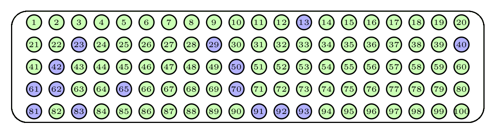
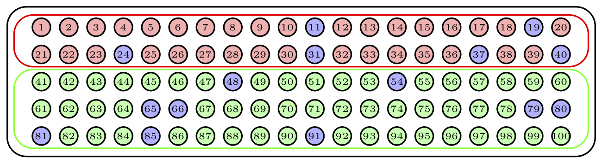
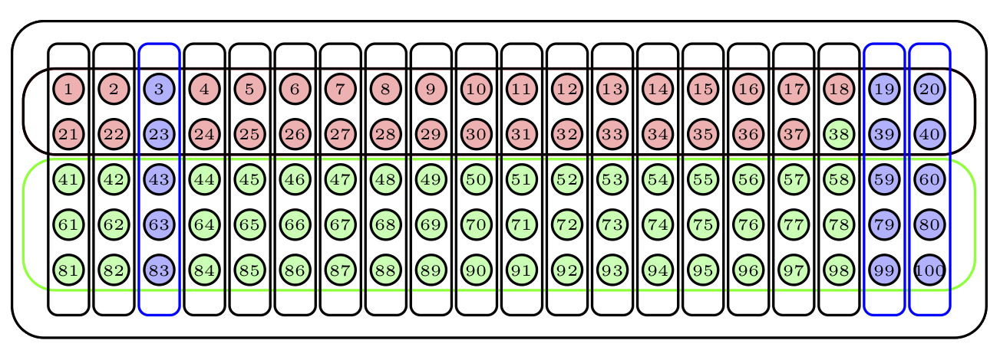

# Estructura de la sesión

1.  [Repaso y Objetivos](#repaso)
2.  [¿Por qué un análisis "simple" falla?](#problema)
3.  [Componentes del Diseño Complejo](#componentes)
4.  [La solución: Ponderación y `survey` / `srvyr`](#solucion)
5.  [Resumen y Próximos Pasos](#resumen)

# 1. Repaso y Objetivos {#repaso}

## ¿Qué vimos en la sesión anterior?

::: incremental
-   Manejo de datos faltantes (imputación, omisión).
-   Union de bases de datos (join)
-   Formatos anchos (wide) y largos (long) para análisis longitudinal.
:::

## Objetivos de Hoy

El objetivo de aprendizaje de esta unidad, según nuestro plan de curso,
es:

> **"Aplicar técnicas de ponderación y diseño muestral complejo para
> análisis válidos en encuestas."**

Al final de esta sesión, seremos capaces de:

1.  Diferenciar un muestreo aleatorio simple (MAS) de un diseño
    complejo.
2.  Identificar los componentes clave: estratos, conglomerados y
    factores de expansión.
3.  Implementar análisis descriptivos ponderados usando el paquete
    `survey` y `srvyr` en R.

# 2. ¿Por qué un análisis "simple" falla? {#problema}

## El escenario ideal (y ficticio)

La mayoría de las funciones que hemos usado hasta ahora (`mean()`,
`lm()`, `count()`) asumen que nuestros datos provienen de un **Muestreo
Aleatorio Simple (MAS)**.

**MAS:** Cada individuo en la población tiene *exactamente la misma
probabilidad* de ser seleccionado para la muestra.



## La realidad sociológica

Las encuestas reales (ELSOC, CASEN, CEP) casi *nunca* son MAS. Son
**Muestreos Complejos**.

¿Por qué?

-   **Eficiencia de costos:** Es más barato entrevistar a 10 personas en
    10 manzanas (conglomerados) que a 100 personas repartidas
    aleatoriamente por todo Santiago.

-   **Precisión estadística:** Queremos asegurar la representación de
    grupos pequeños (ej. inmigrantes, jóvenes rurales). Para esto, los
    "sobre-muestreamos" intencionalmente (estratificación).

## El Problema

Si analizamos datos de una encuesta compleja como si fuera MAS:

1.  **Estimaciones Puntuales (Medias, %):** Serán **incorrectas**
    (sesgadas). Si sobre-muestreamos a jóvenes rurales, la media de edad
    de la muestra será más baja que la de la población, a menos que
    "corrijamos" ese sobre-muestreo.

2.  **Errores Estándar (Intervalos de Confianza):** Serán
    **incorrectos** (generalmente, subestimados). El análisis no
    considerará que las personas de un mismo conglomerado (ej. un
    colegio, una manzana) tienden a parecerse entre sí.

## Consecuencia Práctica

Si usamos `dplyr::summarise(mean(ingreso))` en datos CASEN:

> **El promedio de ingreso que obtendremos estará estadísticamente
> incorrecto y nuestros intervalos de confianza mentirán sobre la
> precisión.**

Esto no es un problema menor. Es la diferencia entre un análisis válido
desde el punto de vista a la inferencia estadística.

# 3. Componentes del Diseño Complejo {#componentes}

## Diseño Muestral Complejo

Generalmente tiene tres componentes clave que debemos informar a R:

1.  **Estratificación (Strata)**
2.  **Conglomerados (Clusters)**
3.  **Ponderadores (Weights) / Factor de Expansión**

------------------------------------------------------------------------

## Componente 1: Estratificación

Dividir la población en subgrupos "homogeneos" (estratos) ANTES del
muestreo. Luego, se saca una muestra de CADA estrato.

-   **Objetivo:** Asegurar la representación de subgrupos específicos y
    mejorar la precisión.
-   **Ejemplo Sociológico:** Estratificar la población chilena por
    `territorio` (urbano/rural). Aseguramos tener gente ambos estratos.
-   **Efecto:** Reduce el error estándar.



------------------------------------------------------------------------

## Componente 2: Conglomerados

Muestrear grupos "naturales" e internamente "heterogéneos" de individuos
(conglomerados) en una primera etapa, para luego muestrear individuos
dentro de esos grupos.

-   **Objetivo:** Eficiencia logística y reducción de costos.
-   **Ejemplo Sociológico:**
    -   *Etapa 1:* Seleccionar 3 ciudades urbanas aleatoriamente.
    -   *Etapa 2:* Seleccionar 5 comunas aleatoriamente *dentro* de cada
        ciudad
-   **Efecto:** Aumenta el error estándar. Las observaciones no son
    independientes; comunas de la misma ciudad se parecen.



------------------------------------------------------------------------

## Componente 3: Ponderador de Diseño (Peso Muestral)

Es la consecuencia directa de tener probabilidades de selección
desiguales.

-   **¿Qué es?** Es el inverso matemático de la probabilidad de
    selección de cada unidad ($i$).
-   **Fórmula:** $w_i = 1 / \pi_i$
-   **Propósito:** Es el primer paso para corregir el sesgo introducido
    por el diseño. Si "sobre-muestreamos" intencionalmente a un grupo
    (aumentando su probabilidad $\pi_i$), su ponderador de diseño
    ($w_i$) será *más bajo*, dándole menos peso en el análisis para
    compensar.
-   **Ejemplo:**
    -   Probabilidad de seleccionar 1 joven rural (sobremuestreo):
        $\pi_{rural} = 1/50$ $\to$ Ponderador: $w_{rural} = 50$.
    -   Probabilidad de seleccionar 1 adulto urbano (submuestreo):
        $\pi_{urbano} = 1/500$ $\to$ Ponderador: $w_{urbano} = 500$.

## Componente 4: Factor de Expansión (Peso Final)

Esta es la variable que *usualmente* encontramos en las bases de datos
(ej. `fexp`, `pw`, `peso`). Es el producto de varios ajustes.

-   **¿Qué es?** Es el Ponderador de Diseño ($w_i$) que ha sido
    *ajustado* para corregir problemas prácticos de la encuesta.
-   **Ajustes Comunes:**
    1.  **Ajuste por No-Respuesta:** Modifica el peso de los que *sí*
        respondieron para que representen a los que *no* respondieron
        (asumiendo que son similares).
    2.  **Calibración / Post-Estratificación:** Ajusta los pesos finales
        para que los totales de la muestra coincidan con totales
        poblacionales conocidos (ej. del Censo, como la distribución por
        edad y sexo del país).
-   **¿Qué significa?** Un `factor_expansion = 400.5` significa que esa
    persona representa a 400.5 individuos en la **población objetivo
    total**.
-   **Uso:** Esta es la variable que usamos en `srvyr` en el argumento
    `weights=`. Al sumarla, deberíamos obtener el tamaño total de la
    población $N$.

# 4. La solución: Ponderación y `survey` / `srvyr` {#solucion}

## El Ecosistema en R

Para manejar estos diseños, no usamos `dplyr` directamente. Usamos
paquetes especializados.

1.  **`survey` (El Clásico):** Creado por Thomas Lumley. Es el motor
    estándar de oro para encuestas en R. Su sintaxis no es "tidyverse".
    -   *Funciones:* `svydesign()`, `svymean()`, `svyglm()`.
2.  **`srvyr` (El Moderno):** Creado por Greg Martin. Es un "envoltorio"
    (wrapper) que traduce la sintaxis `tidyverse` (`|>` y verbos
    `dplyr`) al lenguaje de `survey`.
    -   Es el que usaremos en este curso, alineado con el flujo
        Tidyverse.

## El Flujo de Trabajo con `srvyr`

El análisis de encuestas complejas siempre sigue dos pasos:

**Paso 1: Declarar el Diseño**

-   Es el paso más importante.
-   Le decimos a R: Esta no es una base de datos simple. Tiene estratos,
    conglomerados y/o ponderadores".
-   Usamos la función `as_survey()`.

**Paso 2: Analizar**

-   Usamos funciones de `srvyr` que *respetan* el diseño que declaramos.
-   `survey_mean()`, `survey_total()`, `survey_quantile()`,
    `svytable()`.
-   Podemos usar `group_by()` y `summarise()` como ya sabemos.

# 5. Resumen y Próximos Pasos {#resumen}

## Resumen de la Sesión

1.  Usar funciones "simples" (`mean`, `lm`) en datos de encuestas
    complejas produce resultados **inválidos**.
2.  Los diseños complejos involucran **estratos** (mejoran precisión),
    **conglomerados** (empeoran precisión, pero ahorran costos) y
    **ponderadores** (corrigen estimaciones).
3.  Usamos el paquete `srvyr` por su sintaxis amigable con el
    `tidyverse`.
4.  **Flujo de trabajo:**
    1.  `as_survey()`: Declarar el diseño
    2.  `summarise()` + `survey_mean()`, `survey_total()`,
        `survey_prop()`.
    3.  `group_by()` funciona como siempre.

## Próxima Sesión

En la próxima sesión de la Unidad 2, continuaremos con otro tipo de dato
fundamental en sociología:

**Análisis de datos espaciales**

-   Introducción a los datos geográficos (shapefiles, sf).
-   Mapas básicos y unión de datos espaciales.

## Evaluaciones restantes

**Evaluación 2**

-   Objetivo: finalizar el informe de análisis (informe 1 mejorado +
    hallazgos + conclusión)
-   Fecha de entrega miércoles 03 de diciembre

**Evaluación 3**

-   Objetivo: presentación de resultados
-   Fecha de entrega: viernes 12 de diciembre

# ¡Gracias por la atención!

<!-- ========================== -->

<!-- BARRA SUPERIOR E INFERIOR -->

<!-- ========================== -->

```{=html}
<script>
document.addEventListener('DOMContentLoaded', function() {
  // Crear barra superior
  var sectionBar = document.createElement('div');
  sectionBar.id = 'section-bar';
  sectionBar.innerHTML = `
    <span id="current-section"></span>
    
  `;
  document.body.appendChild(sectionBar);

  // Crear barra inferior
  var footerBar = document.createElement('div');
  footerBar.id = 'footer-bar';
  footerBar.innerHTML = `
    <span id="footer-text">Cristóbal Ortiz Vilches | CC BY-NC 4.0 2026 – Ciencia de Datos Aplicada con RStudio</span>
    <span id="page-counter"></span>
  `;
  document.body.appendChild(footerBar);

  // Capturar secciones principales
  var sectionTitles = [];
  var allSlides = document.querySelectorAll('.reveal .slides section');
  allSlides.forEach(function(slide) {
    let title = slide.querySelector('h1');
    if (title) {
      sectionTitles.push({ title: title.innerText, slide: slide });
    }
  });

  function updateBar(event) {
    let currentSlide = event.currentSlide;
    let currentIndex = Reveal.getSlidePastCount(currentSlide);
    let totalSlides = Reveal.getTotalSlides();

    // Actualiza contador inferior
    document.getElementById('page-counter').innerText = (currentIndex + 1) + "/" + totalSlides;

    const sectionText = document.getElementById('current-section');

    // Oculta la barra en la primera y última diapositiva
    if (currentIndex === 0 || currentIndex === 1 || currentIndex === totalSlides - 1) {
      sectionText.style.visibility = 'hidden';
    } else {
      sectionText.style.visibility = 'visible';

      // Actualiza texto de la sección si corresponde
      for (let i = 0; i < sectionTitles.length; i++) {
        if (sectionTitles[i].slide === currentSlide || sectionTitles[i].slide.contains(currentSlide)) {
          sectionText.innerText = sectionTitles[i].title;
          return;
        }
      }

      // Si no hay coincidencia exacta, busca la sección más cercana anterior
      for (let i = sectionTitles.length - 1; i >= 0; i--) {
        if (Reveal.getSlidePastCount(sectionTitles[i].slide) <= currentIndex) {
          sectionText.innerText = sectionTitles[i].title;
          return;
        }
      }
    }
  }

  Reveal.on('slidechanged', updateBar);
  Reveal.on('ready', updateBar);
});
</script>
```
