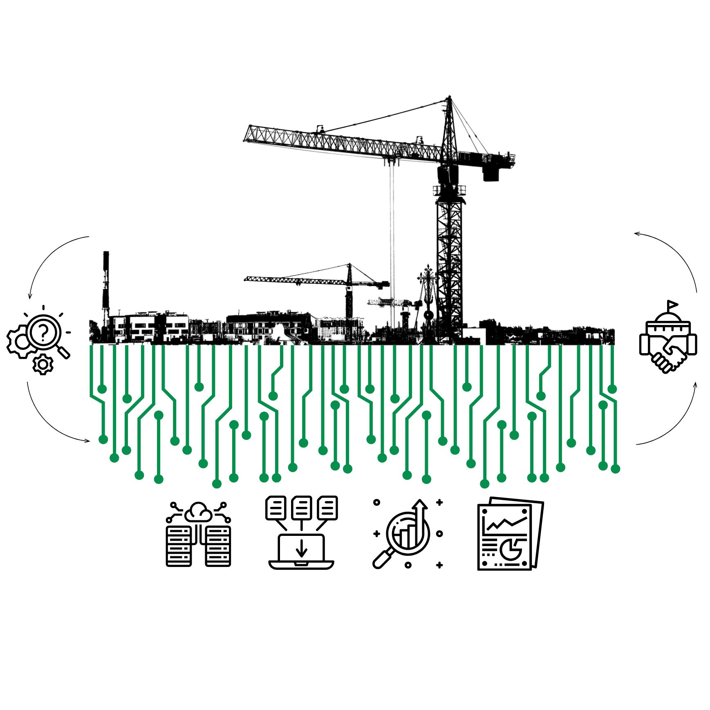
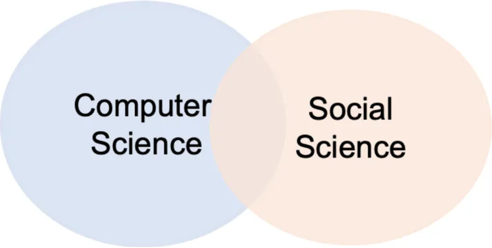
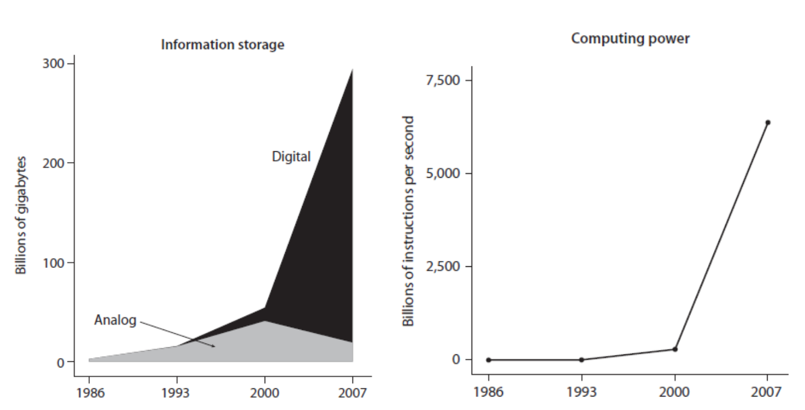
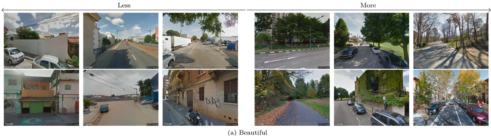
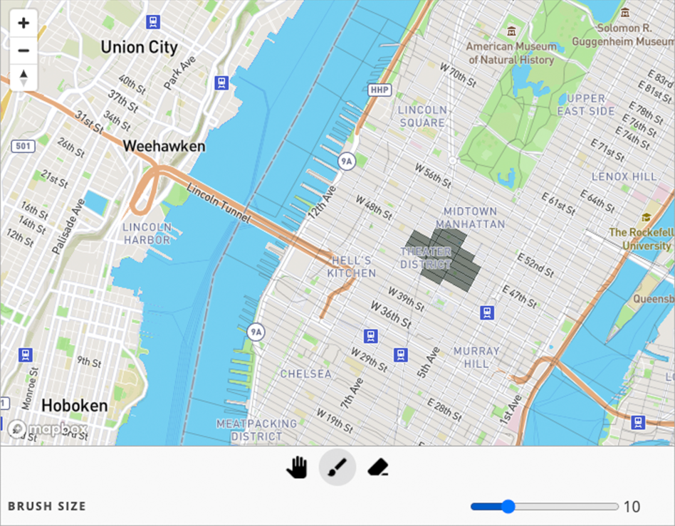
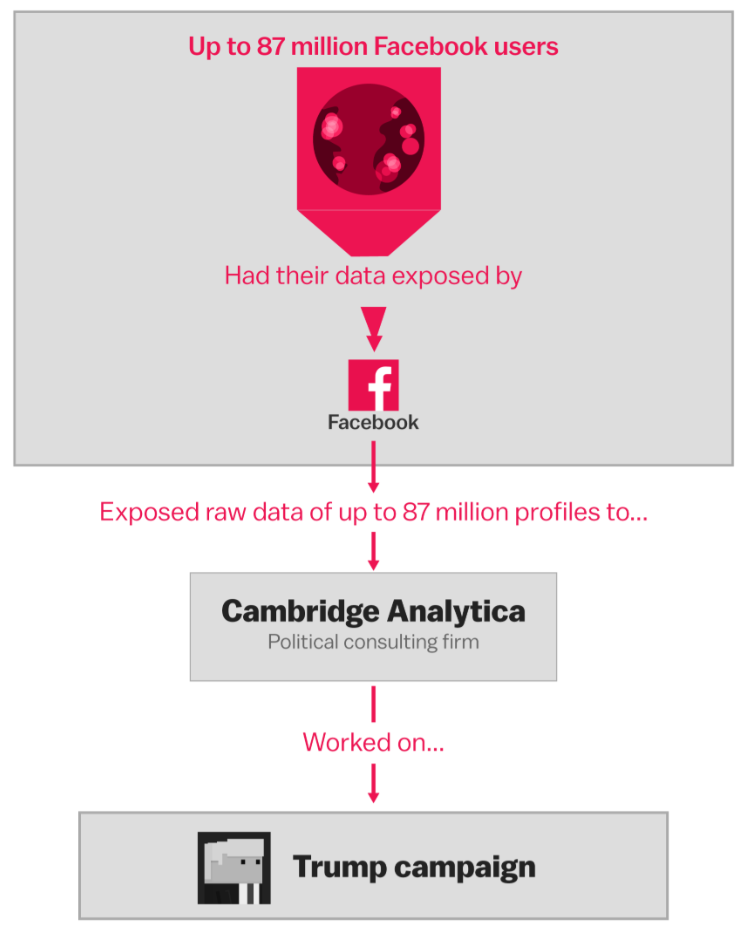
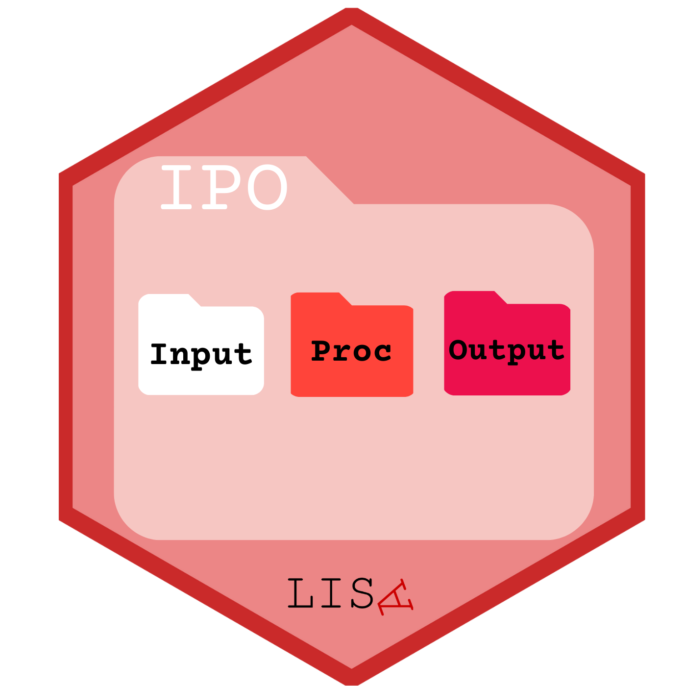
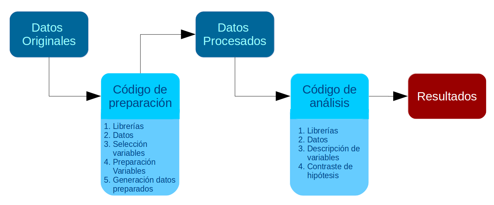
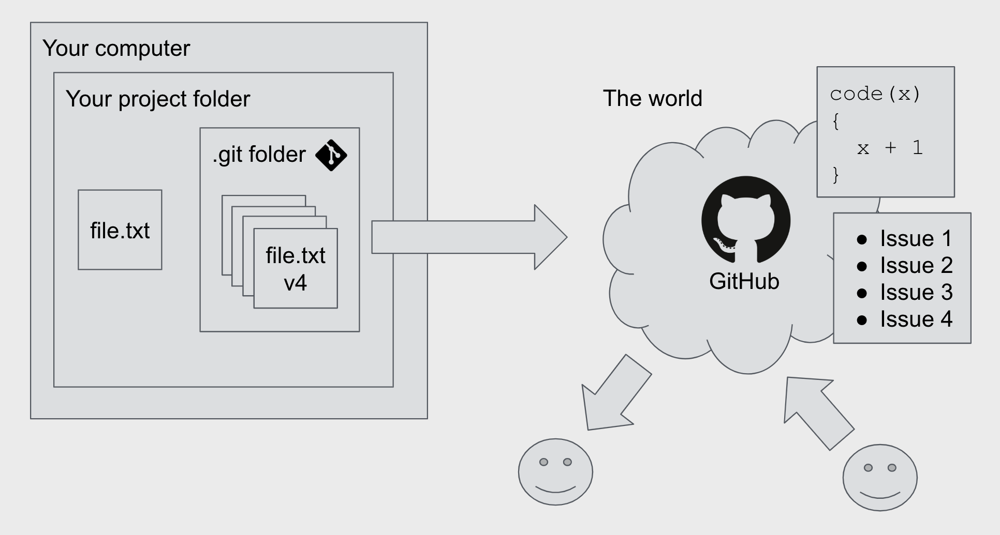

# Estructura de la presentación

1.  [Presentación del curso](#presentación)

2.  [¿Qué es la ciencia social computacional?](#cienciacompu)

3.  [El ecosistema de datos digitales](#ecosistema)

4.  [Diseño de investigación y ética](#diseño)

5.  [Protocolos de trabajo en CSS](#protocolo)

6.  [Programa del curso](#programa)

7.  [Resumen de la sesión](#resumen)

# Presentación del curso {#presentación}

## Sobre mí

::::: columns
::: {.column width="50%"}
-   **Formación**

    -   Sociólogo y Magíster en Desarrollo Urbano

    -   Actualmente curso un diplomado en Estadística

-   **Especialización**

    -   Metodología Cuantitativa

    -   Moldeamiento estadístico

    -   Sociología Urbana

-   **Experiencia**

    -   Investigación empírica cuantitativa en COES y Fondecyt

    -   Docencia en RStudio, Ciencia de datos, Metodología Cuantitativa
:::

::: {.column width="50%"}

:::
:::::

## Sobre ustedes

-   Nombre

-   Proyecto de tesis

-   Especialización teórica y metodológica

-   Experiencia previa en análisis de datos

-   Expectativa sobre el curso

## Modalidad del curso

::::: columns
::: {.column width="50%"}
-   Sesiones

    -   12 en total entre el 14 de agosto y el 11 de diciembre

    -   Horario original: incluye 3 bloques de 1 hora cada uno

    -   **Horario adaptado: 2 bloques**

        -   Parte teórica: entre 10:50 y 11:50

        -   Parte práctica: entre 11:55 y 14:10

-   Preguntas y participación

    -   Preguntas cortas en cualquier momento

    -   Preguntas elaboradas en las transiciones

    -   Asignación de décimas a quienes planteen buenas preguntas y participen
:::

::: {.column width="50%"}
-   Foco del curso

    -   Ciencia computacional con foco en herramientas de gestión de proyectos de investigación con datos

    -   Comprensión del ***por qué*** y no tanto el *como* hacemos las cosas

    -   Hoy es más sencillo que antes programar (IA generativa)
:::
:::::

<!-- ========================== -->

# ¿Qué es la ciencia social computacional? {#cienciacompu}

## Definición

:::::: columns
:::: {.column width="50%"}
::: incremental
-   La ciencia social computacional es una subdisciplina de las ciencias sociales que utiliza modelos computacionales para comprender el comportamiento humano en el entorno digital.

    -   huella digital (dato) $\to$ comportamiento humano (información)

-   ¿Para qué?: para comprender mejor el comportamiento humano ante en la era digital.

-   Lo computacional no sólo es una herramienta metodológica (como ocurre en el data science), sino que es fundamentalmente un paradigma teórico que orienta el diseño de investigación y el objeto de estudio.
:::
::::

::: {.column width="50%"}
{width="632"}
:::
::::::

## Contexto

::::::: columns
::::: {.column width="40%"}
Transición de la era de información analógica a la digital. Dos tendencias simultaneas:

::: incremental
1.  Explosión de la producción y almacenamiento de la información digital $\to$ ***big data***.
2.  Crecimiento en el acceso al poder computacional $\to$ ***microprocesadores (CPU)***
:::

::: fragment
Este curso enmarca la CSS como un cambio de paradigma que altera la naturaleza de las preguntas que podemos formular, las teorías que podemos construir y la evidencia que podemos recopilar
:::
:::::

::: {.column width="60%"}
{width="100%"}
:::
:::::::

## Ciencia Computacional y Sociología

::: incremental
-   En nuestro contexto sociológico: la integración entre sociología y ciencia computacional es mucho más sustantiva y, por lo tanto, mucho más compleja en comparación a la ciencia de datos.
    -   En la **era digital los objetos de la sociología se expanden y transforman**
    -   En este sentido, lo "computacional" no es sólo una herramienta *para* la sociología, sino *parte* integrante del diseño de investigación.
-   ¿Cuál es el objeto de estudio de la ciencia de datos?
:::

# El ecosistema de datos digitales {#ecosistema}

## La huella digital

Una parte creciente de la interacción humana deja una masiva "huella digital": rastros de texto, imágenes, métricas de interacción y metadatos. Estos datos, a menudo generados por empresas y gobiernos, son un recurso invaluable pero también presentan desafíos.

Tipos de Datos Digitales: 

::: incremental 
- **Datos Textuales**: Publicaciones en redes sociales, reseñas de productos, transcripciones de discursos, corpus de libros digitalizados. Permiten el estudio del lenguaje y el discurso público.

-   **Datos de Red**: Conexiones de amistad en Facebook, redes de "seguidores" en X, patrones de colaboración científica, acuerdos comerciales entre países. Revelan la estructura de las relaciones sociales.

-   **Datos Geoespaciales**: Datos de GPS de teléfonos móviles, check-ins en lugares, imágenes satelitales. Permiten analizar la movilidad, la segregación y la interacción con el entorno físico.

-   **Datos de Comportamiento**: Registros de llamadas, historiales de compra, patrones de navegación web. Ofrecen una visión granular de las acciones y decisiones individuales.
:::

## Características de los big data

Los datos digitales masivos tienen características que los diferencian de los datos de encuestas tradicionales:

::: incremental
-   **Siempre activos (Always-on):** Se recopilan de forma continua, permitiendo el estudio de dinámicas en tiempo real.

-   **No reactivos:** A menudo se recopilan sin que los individuos modifiquen su comportamiento, a diferencia de una entrevista.

-   **Incompletos:** Frecuentemente carecen de información demográfica clave.

-   **Inaccesibles:** A menudo son propiedad de empresas y su acceso puede ser restringido.

-   **No representativos:** Los usuarios de una plataforma específica rara vez son una muestra representativa de la población general.

-   **Deriva (Drifting):** Las plataformas cambian sus algoritmas y bases de usuarios, lo que significa que lo que se mide hoy puede no ser lo mismo que se medía ayer.
:::

## Métodos de adquisición de datos

::: incremental
-   **APIs (Interfaces de Programación de Aplicaciones):** Son puertas de enlace estructuradas que las plataformas (como X, Reddit, YouTube) ofrecen para acceder a sus datos de manera controlada y ética. Permiten a los investigadores solicitar datos específicos sin sobrecargar los servidores de la empresa.

-   **Web Scraping:** Es el proceso de escribir un programa para extraer información directamente del código HTML de las páginas web. Es una técnica poderosa pero que requiere una cuidadosa consideración de los términos de servicio del sitio web y de la ética de la recolección.

-   **Bancos de Datos Históricos:** Repositorios a gran escala como Seshat, D-PLACE y Clio-Infra proporcionan datos estructurados para el análisis social a largo plazo.
:::

::: fragment
{fig-align="center" width="75%"}
:::

# Diseño de investigación y ética en la era digital {#diseño}

## Lo nuevo *versus* lo viejo

Los conceptos tradicionales de diseño de investigación no se abandonan, sino que se adaptan. 

::: incremental 
- Muestreo y Representatividad: El desafío central es cómo hacer inferencias sobre una población general a partir de datos de una subpoblación específica y a menudo sesgada (p. ej., usuarios de X). Se explorarán estrategias como la post-estratificación para corregir estos sesgos. 
- Validez y Fiabilidad: ¿Estamos midiendo realmente el constructo social que nos interesa? La validez de las mediciones digitales (p. ej., usar "likes" como indicador de apoyo político) debe ser evaluada críticamente. 
:::

## Nuevos diseños de investigación

:::::: columns
::: {.column width="50%"}
La era digital permite diseños de investigación que antes eran inviables:

::: incremental
-   **Experimentos Digitales y Pruebas A/B:** La capacidad de aleatorizar a millones de usuarios a diferentes condiciones (p. ej., mostrar diferentes titulares de noticias) permite medir efectos causales con una precisión estadística sin precedentes.

-   **Encuestas Digitales Amplificadas:** Combinar las respuestas de encuestas tradicionales (ricas en demografía y actitudes) con datos de comportamiento digital (ricos en observaciones a lo largo del tiempo) para obtener una visión más completa.

-   **Colaboración Masiva (Ciencia Ciudadana):** Involucrar a miles de voluntarios en tareas de investigación, como la codificación de datos o la resolución de problemas complejos que superan la capacidad de un solo equipo de investigación.
:::
:::

:::: {.column width="50%"}
::: fragment
{fig-align="right"}
:::
::::
::::::

## Ética y responsabilidad en la era digital

La CSS otorga a los investigadores un poder creciente para observar e intervenir en la vida de las personas, a menudo sin su consentimiento o conocimiento explícito

Cuatro principios éticos fundamentales adaptados a la investigación digital: 

::: incremental 
1. **Respeto por las Personas:** Tratar a los individuos como agentes autónomos y proteger a aquellos con autonomía disminuida.

2.  **Beneficencia:** Maximizar los posibles beneficios y minimizar los posibles daños.

3.  **Justicia:** Distribuir los beneficios y las cargas de la investigación de manera equitativa.

4.  **Respeto por la Ley y el Interés Público:** Cumplir con las leyes, los contratos y los términos de servicio, y ser transparente en los procedimientos. 
:::

## Dilemas éticos

::::::: columns
:::: {.column width="50%"}
::: incremental
-   **Privacidad y Anonimato:** Las opiniones vertidas en RRSS van con nombre y apellido. El hecho de que sea pública no da derecho a usarla con fines políticos y de investigación

-   **Consentimiento Informado en la Era Digital:** ¿Es el "clic" en los "Términos y Condiciones" un consentimiento verdaderamente informado?

-   **Sesgo Algorítmico y Equidad:** Los algoritmos de aprendizaje automático, entrenados con datos históricos, pueden aprender y amplificar sesgos sociales existentes (raciales, de género, etc.).

-   **Dilemas de la Investigación Observacional:** ¿Es ético analizar conversaciones "públicas" en foros en línea sobre temas sensibles como la salud mental sin el consentimiento de los participantes?
:::
::::

:::: {.column width="50%"}
::: fragment
{width="65%"}
:::
::::
:::::::

<!-- ========================== -->

# Protocolos de trabajo en CSS {#protocolo}

## Más allá de los fuegos artificiales

La CSS es cool y, sin duda, seguirá transformando el quehacer sociológico. Pero, mientras tanto, **tenemos que trabajar**.

::: incremental
-   La era digital aumenta el volumen de datos, lo cual complejiza su gestión

-   Si bien los procesamientos computacionales se encargan de los calculos dificiles...

-   ... Nosotros tomamos las decisiones sobre qué datos recopilar, cómo organizarlos, de qué manera analizarlos y, finalmente, qué y cómo mostrar la información.

-   Para mejorar esta tomar de decisiones (y colaborar), es necesario establecer un **protocolo de trabajo de datos**
:::

## Protocolo de análisis de datos IPO

:::::: columns
::: {.column width="40%"}
-   Es un flujo de investigación basada en basado en el protocolo TIER (Integridad de Enseñanza en Investigación Empírica)
-   Busca transparencia y replicabilidad del análisis de datos mediante proyectos autocontenidos que cualquiera pueda ejecutar y re‐ejecutar.

{alt="Source: Juan Carlos Castillo en https://lisa-coes.netlify.app/ipo-repro/" fig-align="center" width="50%"}
:::

:::: {.column width="60%"}
### **INPUT \| PROCESSING \| OUTPUT**

::: fragment

:::
::::
::::::

## Control de versiones

Al ser la CSS multi e interdisciplinaria, la colaboración se vuelve crucial. Para colaborar no basta con un protocolo claro, también necesitamos controlar versiones. para ello utilizaremos **Git/Github**

{width="80%"}

<!-- ========================== -->

# Programa del curso {#programa}

## Primera unidad

+--------------------------------------------------------------------+-----------------------------------------------------------------------------------------------------------------+------------------------------------------------------------------------------------------+
| Contenidos                                                         | Aprendizaje                                                                                                     | Evaluación                                                                               |
+====================================================================+=================================================================================================================+==========================================================================================+
| [Introducción: investigación social en la era digital]{.underline} | [El estudiante será capaz de:]{.underline}                                                                      | Informe 1: problematización (20%)                                                        |
|                                                                    |                                                                                                                 |                                                                                          |
| -   Introducción a las CSCC y programa                             | -   Comprender el alcance del curso, su metodología y la trayectoria de las ciencias sociales computacionales.  | -   Problematiza un objeto de estudio en el campo de la ciencia social computacional     |
|                                                                    |                                                                                                                 |                                                                                          |
| -   Introducción al diseño de investigación en CSCC                | -   Aplicar conceptos de diseño de investigación social al análisis de nuevas fuentes de datos digitales.       | -   Comprende el rol de la ciencia social computacional en la investigación sociológica. |
|                                                                    |                                                                                                                 |                                                                                          |
| -   Introducción al flujo de trabajo con datos                     | -   Conocer las etapas del tratamiento y análisis de datos en un proyecto de ciencias sociales computacionales. |                                                                                          |
+--------------------------------------------------------------------+-----------------------------------------------------------------------------------------------------------------+------------------------------------------------------------------------------------------+

## Segunda unidad

+-----------------------------------------+-------------------------------------------------------------------------------------------------+---------------------------------------------------------------------------------------------+
| Contenidos                              | Aprendizaje                                                                                     | Evaluación                                                                                  |
+=========================================+=================================================================================================+=============================================================================================+
| [Diseño en CSCC]{.underline}            | [El estudiante será capaz de:]{.underline}                                                      | [Informe 2: resultados preliminares (40%)]{.underline}                                      |
|                                         |                                                                                                 |                                                                                             |
| -   La crisis de la ciencia abierta     | -   Reconocer la importancia de la ciencia abierta para la investigación.                       | -   Demuestra dominio en las herramientas para gestionar proyectos de investigación en CSCC |
|                                         |                                                                                                 |                                                                                             |
| -   Flujos reproducibles                | -   Implementar un flujo de trabajo reproducible                                                | -   Identifica y aplica técnicas de análisis de la CSCC                                     |
|                                         |                                                                                                 |                                                                                             |
| -   Control de versiones y repositorios | -   Utilizar herramientas para el control de versiones y la gestión de proyectos colaborativos. |                                                                                             |
|                                         |                                                                                                 |                                                                                             |
| -   Producción de datos en CSCC         | -   Distinguir diferentes técnicas de producción y recolección de datos.                        |                                                                                             |
|                                         |                                                                                                 |                                                                                             |
| -   Técnicas de análisis en CSCC        | -   Aplicar técnicas para el análisis                                                           |                                                                                             |
+-----------------------------------------+-------------------------------------------------------------------------------------------------+---------------------------------------------------------------------------------------------+

## Tercera unidad
  
+---------------------------------------------------------+---------------------------------------------------------------------------------------------------------+-------------------------------------------------------------------------------------+
| Contenidos                                              | Aprendizaje                                                                                             | Evaluación                                                                          |
+=========================================================+=========================================================================================================+=====================================================================================+
| [Aspectos éticos y comunicación en CSCC]{.underline}    | [El estudiante será capaz de:]{.underline}                                                              | [Informe 3: resultados finales (40%)]{.underline}                                   |
|                                                         |                                                                                                         |                                                                                     |
| -   Presentación y discusión de resultados preliminares | -   Comunicar y discutir los avances de los proyectos de investigación en curso.                        | -   Identifica aspectos éticos en la ciencia social computacional                   |
|                                                         |                                                                                                         |                                                                                     |
| -   Aprendizaje automatizado en Ciencias Sociales       | -   Explorar la aplicación de técnicas de aprendizaje automatizado en la investigación sociológica.     | -   Desarrolla y aplica habilidades de comunicación en ciencia social computacional |
|                                                         |                                                                                                         |                                                                                     |
| -   Ética de la investigación social                    | -   Analizar los aspectos éticos que presenta la era digital en el contexto de la investigación social. |                                                                                     |
|                                                         |                                                                                                         |                                                                                     |
| -   Taller: comunicación de resultados en CSCC          | -   Desarrollar habilidades para la comunicación efectiva de hallazgos en investigación.                |                                                                                     |
+---------------------------------------------------------+---------------------------------------------------------------------------------------------------------+-------------------------------------------------------------------------------------+

<!-- ========================== -->

# Resumen de la sesión {#resumen}

## Síntesis

::: incremental
1.  La era digital está **cambiando radicalmente** nuestra manera de comunicarnos y relacionarnos

2.  La ciencia social computacional no se reduce a una herramienta, **es un paradigma** que produce un objeto de estudio

3.  La big data desafía los diseños de investigación actuales, sobre todo los **aspectos éticos**

4.  Para el diseño de investigación en CSCC es necesario un **protocolo** para trabajar ordenadamente los datos
:::

# ¡Gracias por la atención!

<!-- ========================== -->

<!-- BARRA SUPERIOR E INFERIOR -->

<!-- ========================== -->

```{=html}
<script>
document.addEventListener('DOMContentLoaded', function() {
  // Crear barra superior
  var sectionBar = document.createElement('div');
  sectionBar.id = 'section-bar';
  sectionBar.innerHTML = `
    <span id="current-section"></span>
    
  `;
  document.body.appendChild(sectionBar);

  // Crear barra inferior
  var footerBar = document.createElement('div');
  footerBar.id = 'footer-bar';
  footerBar.innerHTML = `
    <span id="footer-text">Cristóbal Ortiz Vilches | CC BY-NC 4.0 2026 – Ciencias Sociales Computacionales</span>
    <span id="page-counter"></span>
  `;
  document.body.appendChild(footerBar);

  // Capturar secciones principales
  var sectionTitles = [];
  var allSlides = document.querySelectorAll('.reveal .slides section');
  allSlides.forEach(function(slide) {
    let title = slide.querySelector('h1');
    if (title) {
      sectionTitles.push({ title: title.innerText, slide: slide });
    }
  });

  function updateBar(event) {
    let currentSlide = event.currentSlide;
    let currentIndex = Reveal.getSlidePastCount(currentSlide);
    let totalSlides = Reveal.getTotalSlides();

    // Actualiza contador inferior
    document.getElementById('page-counter').innerText = (currentIndex + 1) + "/" + totalSlides;

    const sectionText = document.getElementById('current-section');

    // Oculta la barra en la primera y última diapositiva
    if (currentIndex === 0 || currentIndex === 1 || currentIndex === totalSlides - 1) {
      sectionText.style.visibility = 'hidden';
    } else {
      sectionText.style.visibility = 'visible';

      // Actualiza texto de la sección si corresponde
      for (let i = 0; i < sectionTitles.length; i++) {
        if (sectionTitles[i].slide === currentSlide || sectionTitles[i].slide.contains(currentSlide)) {
          sectionText.innerText = sectionTitles[i].title;
          return;
        }
      }

      // Si no hay coincidencia exacta, busca la sección más cercana anterior
      for (let i = sectionTitles.length - 1; i >= 0; i--) {
        if (Reveal.getSlidePastCount(sectionTitles[i].slide) <= currentIndex) {
          sectionText.innerText = sectionTitles[i].title;
          return;
        }
      }
    }
  }

  Reveal.on('slidechanged', updateBar);
  Reveal.on('ready', updateBar);
});
</script>
```
