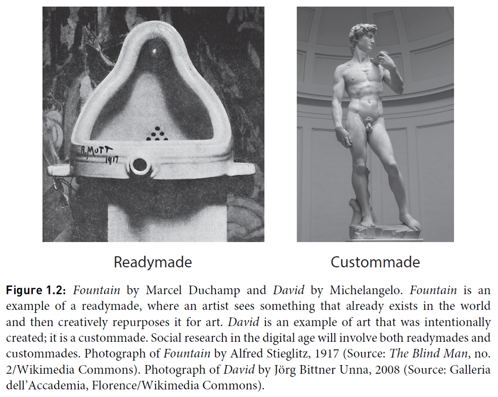

# Estructura de la presentación

1.  [Recordando la sesión anterior](#recap)
2.  [¿Qué es el diseño de investigación?](#diseno)
3.  [La investigación social en la era digital](#digital)
5.  [Reevaluando enfoques tradicionales](#reevaluacion)
6.  [Nuevas fuentes de datos, nuevas preguntas](#nuevasfuentes)
7.  [Hacia un nuevo enfoque de diseño](#enfoque)
8.  [Resumen y próximos pasos](#resumen)

# 1. Recordando la sesión anterior {#recap}

## ¿Qué vimos?
::: incremental
-   **Definimos las Ciencias Sociales Computacionales (CSCC)** como un
    campo interdisciplinario que utiliza métodos computacionales para
    analizar datos sociales a gran escala.
-   **Abordamos la era digital** y sus implicacias para el diseño de investigación
-   **Exploramos el ecosistema de datos digitales**: desde redes
    sociales hasta registros administrativos.
-   Discutimos la **importancia de la ética y la reproducibilidad** en
    este nuevo paradigma.
-   Se introdujo el **protocolo de trabajo IPO** (Input-Process-Output)
    como un flujo de trabajo fundamental.
:::

# 2. ¿Qué es el diseño de investigación? {#diseno}

## El plan maestro

Un **diseño de investigación** es un plan o estrategia concebida para
obtener la información que se desea con el fin de responder al problema
de investigación.

. . .

**En simple:** Es el *mapa* que guía al investigador desde la pregunta
inicial hasta las conclusiones.

. . .

Componentes clave:

-   Pregunta de investigación
-   Unidades de análisis
-   Estrategia de recolección/producción de datos
-   Técnicas de análisis
-   Consideraciones éticas

## Tipos de diseño tradicionales

| Tipo de Diseño | Propósito Principal | Ejemplo Clásico en Sociología |
|-----------------|---------------------------|---------------------------|
| **Exploratorio** | Examinar un tema o problema poco estudiado | Entrevistas a líderes de un nuevo movimiento social. |
| **Descriptivo** | Especificar propiedades y características de un fenómeno. | Caracterizar la composición socioeconómica de los barrios |
| **Correlacional** | Asociar variables o conceptos. | Analizar la relación entre nivel educativo e ingresos |
| **Explicativo** | Determinar los factores asociados a un variables | Determinar por qué ciertos grupos votan más que otros |
| **Experimental** | Establecer relaciones causales (causa-efecto). | Asignar aleatoriamente un programa social a un grupo. |

# 3. La investigación social en la era digital {#digital}

## Un cambio de paradigma

La era digital no solo nos da *más* datos, sino que nos ofrece **tipos
de datos fundamentalmente diferentes**. Esto nos obliga a repensar cómo
diseñamos nuestras investigaciones.

. . .

> "La era digital está en todas partes, ha cambiado la forma en que vivimos y, por lo tanto, debería cambiar la forma en que investigamos".
> — Matthew Salganik en "Bit by Bit"

## Dos mundos de datos

Salganik distingue entre dos tipos de fuentes de datos que ahora tenemos a nuestra disposición:

::::: columns
::: {.column width="60%"}
1.  **Datos "Diseñados" (Custommade)**:
    -   Creados específicamente para la investigación.
    -   Ejemplos: Encuestas, experimentos de laboratorio.
    -   **Ventaja**: Adaptados a la pregunta de investigación.
    -   **Desventaja**: Costosos y lentos.

::: {.fragment}
2.  **Datos "Encontrados" u "Orgánicos" (Readymades)**:
    -   Producidos para otros fines (comerciales, administrativos,
        sociales).
    -   Ejemplos: Datos de redes sociales, registros de llamadas, datos
        de sensores.
    -   **Ventaja**: Masivos, en tiempo real, no reactivos.
    -   **Desventaja**: Ruidosos, incompletos, no representativos,
        pueden tener sesgos.
        
:::
:::

::: {.column width="40%"}
{fig-align="right"}
:::
:::::

# 4. Reevaluando enfoques tradicionales {#reevaluacion}

## Población y Muestra: Un nuevo dilema

En la investigación tradicional, nos esforzamos por obtener una muestra
**representativa** de una población bien definida.

. . .

Con Big Data, a menudo tenemos datos de **toda la población** de una
plataforma (N=todos), pero esa población no es representativa de la
sociedad.

  - **Ejemplo**: Un estudio sobre discurso político en Twitter. Tenemos *casi todos los tuits* de Chile (N≈todos los
  tuiteros), pero los usuarios de Twitter tienden a ser más jóvenes, más urbanos y con mayor nivel educativo que el
  promedio nacional.

. . .

**Pregunta para la clase**: ¿Es mejor tener una muestra pequeña pero
representativa, o datos masivos pero sesgados?

## El fin de las encuestas (¿o no?)

Con la abundancia de datos de comportamiento, algunos proclamaron "el
fin de la teoría" y de las encuestas.

. . .

**Error**: Los datos de comportamiento nos dicen **QUÉ** hacen las
personas, pero no **POR QUÉ** lo hacen.

. . .

**Solución**: Combinar datos. Usar la escala de los datos masivos y la
profundidad de las encuestas. - **Ejemplo**: Identificar patrones de
movilidad urbana con datos de celulares (Big Data) y luego encuestar a
una muestra de personas para entender las razones de sus desplazamientos
(propósito del viaje, satisfacción, etc.).

# 5. Nuevas fuentes de datos, nuevas preguntas {#nuevasfuentes}

## Formulando preguntas de investigación

El acceso a nuevos datos nos permite hacer preguntas que antes eran
imposibles de responder.

-   **Antes**: ¿Cómo se difunde un rumor en una comunidad pequeña?
    (requería observación etnográfica).
-   **Ahora**: ¿Cómo se difunden las noticias falsas a nivel nacional en
    tiempo real durante una elección? (analizando millones de retuits).

## De lo macro a lo micro (y viceversa)

La granularidad de los datos digitales permite conectar fenómenos a
diferentes escalas.

-   **Segregación residencial**: Antes la medíamos con datos del Censo a
    nivel de manzana o zona censal.
-   **Segregación experimentada**: Ahora, con datos de GPS, podemos
    medir con quiénes interactúan realmente las personas en su vida
    diaria, revelando una segregación mucho más fina en el transporte,
    el trabajo y el ocio.

## Proponiendo iniciativas pertinentes

Las CSCC son un campo eminentemente **aplicado**. El diseño de nuestra
investigación debe estar orientado a proponer iniciativas pertinentes a
problemas sociales.

. . .

**Ejemplo**: 

- **Problema**: Evasión en el transporte público. 
- **Diseño de investigación tradicional**: Encuestar a usuarios sobre sus
motivos para no pagar.
- **Diseño de investigación en CSCC**: 
  1. Analizar datos de validación de tarjetas Bip! para identificar patrones
  de evasión (estaciones, horarios, rutas). 
  2. Cruzar estos datos con
  información socioeconómica de las zonas (datos censales). 
  3. Realizar
  análisis de sentimiento en redes sociales sobre el sistema de
  transporte. 
  4. **Iniciativa propuesta**: Rediseñar rutas o focalizar la
  fiscalización basándose en la evidencia encontrada.

# 6. Hacia un nuevo enfoque de diseño {#enfoque}

## Diseños de investigación híbridos

La clave no es abandonar los métodos tradicionales, sino **integrarlos**
de manera creativa.

| Estrategia                      | Descripción                                                                               |
|:--------------------------------|:------------------------------------------------------------------------------------------|
| **Enriquecer encuestas** | Vincular respuestas de encuestas con datos de comportamiento digital (con consentimiento).  |
| **Muestreo inteligente** | Usar Big Data para identificar subpoblaciones de interés y luego encuestarlas.              |
| **Experimentos de campo digitales** | Realizar experimentos a gran escala dentro de plataformas digitales (ej. A/B testing).    |

## El ciclo de la investigación en CSCC

Un proyecto de CSCC a menudo sigue un ciclo iterativo:

::: incremental
1.  **Exploración**: Se comienza explorando un conjunto de datos
    masivos.
2.  **Generación de hipótesis**: De la exploración surgen patrones y
    preguntas.
3.  **Diseño específico**: Se diseña un estudio más acotado (quizás una
    encuesta o un experimento) para testear esas hipótesis.
4.  **Análisis y modelamiento**: Se analizan los datos recolectados.
5.  **Comunicación**: Se comunican los resultados de forma transparente
    y reproducible.
:::

# 7. Resumen y próximos pasos {#resumen}

## Ideas clave de la sesión

-   El diseño de investigación es nuestro **plan estratégico**.
-   La era digital nos ofrece datos **masivos y orgánicos** que
    complementan los datos diseñados (encuestas, experimentos).
    presentan oportunidades y desafíos.
-   Debemos **reevaluar conceptos** como validez y representatividad.
-   El futuro está en los **diseños híbridos**, que combinan la escala
    de los datos masivos con la profundidad de los métodos
    tradicionales.

## Próxima sesión

**Tema**: La crisis de accesibilidad y la ciencia abierta.

-   ¿Por qué es crucial que la ciencia sea abierta y reproducible?
-   Flujos de trabajo reproducibles: El protocolo IPO en la práctica.
-   Herramientas para el control de versiones y el trabajo colaborativo:
    una introducción a Git y GitHub.
-   Taller práctico: Configuración de un entorno de trabajo reproducible

# ¡Gracias por la atención!

<!-- ========================== -->

<!-- BARRA SUPERIOR E INFERIOR -->

<!-- ========================== -->

```{=html}
<script>
document.addEventListener('DOMContentLoaded', function() {
  // Crear barra superior
  var sectionBar = document.createElement('div');
  sectionBar.id = 'section-bar';
  sectionBar.innerHTML = `
    <span id="current-section"></span>
    
  `;
  document.body.appendChild(sectionBar);

  // Crear barra inferior
  var footerBar = document.createElement('div');
  footerBar.id = 'footer-bar';
  footerBar.innerHTML = `
    <span id="footer-text">Cristóbal Ortiz Vilches | CC BY-NC 4.0 2026 – Ciencias Sociales Computacionales</span>
    <span id="page-counter"></span>
  `;
  document.body.appendChild(footerBar);

  // Capturar secciones principales
  var sectionTitles = [];
  var allSlides = document.querySelectorAll('.reveal .slides section');
  allSlides.forEach(function(slide) {
    let title = slide.querySelector('h1');
    if (title) {
      sectionTitles.push({ title: title.innerText, slide: slide });
    }
  });

  function updateBar(event) {
    let currentSlide = event.currentSlide;
    let currentIndex = Reveal.getSlidePastCount(currentSlide);
    let totalSlides = Reveal.getTotalSlides();

    // Actualiza contador inferior
    document.getElementById('page-counter').innerText = (currentIndex + 1) + "/" + totalSlides;

    const sectionText = document.getElementById('current-section');

    // Oculta la barra en la primera y última diapositiva
    if (currentIndex === 0 || currentIndex === 1 || currentIndex === totalSlides - 1) {
      sectionText.style.visibility = 'hidden';
    } else {
      sectionText.style.visibility = 'visible';

      // Actualiza texto de la sección si corresponde
      for (let i = 0; i < sectionTitles.length; i++) {
        if (sectionTitles[i].slide === currentSlide || sectionTitles[i].slide.contains(currentSlide)) {
          sectionText.innerText = sectionTitles[i].title;
          return;
        }
      }

      // Si no hay coincidencia exacta, busca la sección más cercana anterior
      for (let i = sectionTitles.length - 1; i >= 0; i--) {
        if (Reveal.getSlidePastCount(sectionTitles[i].slide) <= currentIndex) {
          sectionText.innerText = sectionTitles[i].title;
          return;
        }
      }
    }
  }

  Reveal.on('slidechanged', updateBar);
  Reveal.on('ready', updateBar);
});
</script>
```
