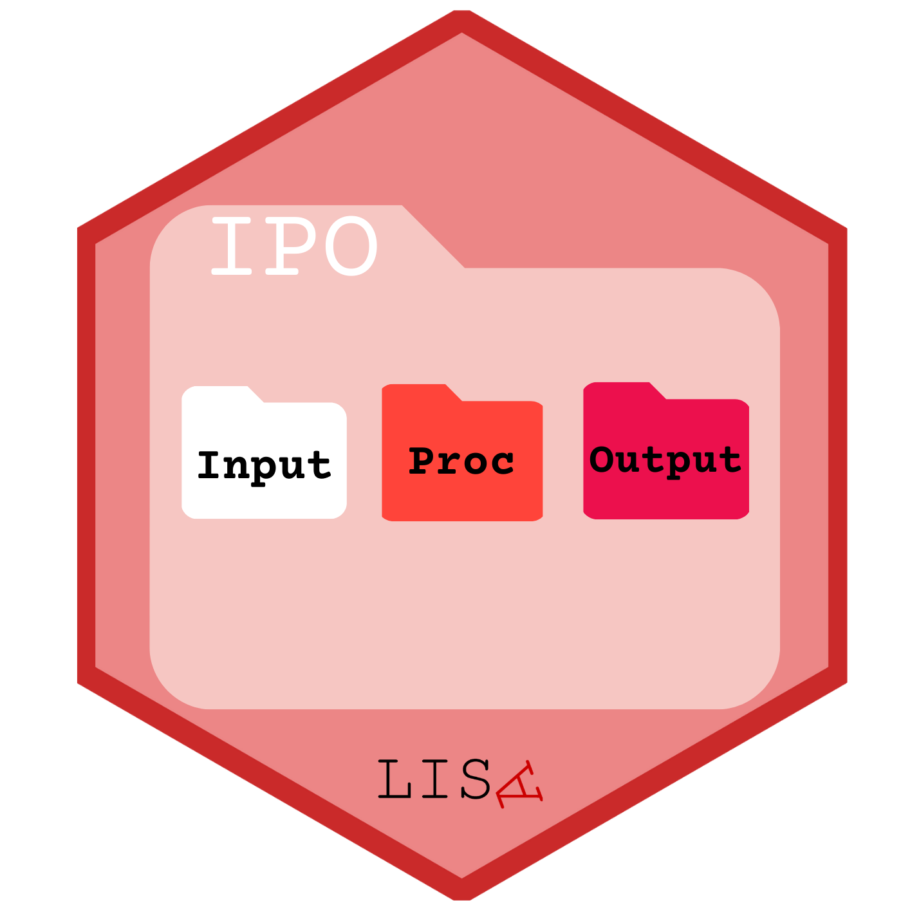

# Estructura de la presentación

1.  [Recordando la sesión anterior](#recap)
2.  [La crisis de accesibilidad y la ciencia abierta](#crisis-acceso)
3.  [¿Qué es la reproducibilidad?](#reproducibilidad)
4.  [El Protocolo de Análisis de Datos IPO](#protocolo-ipo)
5.  [Repaso: configurando un proyecto reproducible](#repaso-reproducible)

# 1. Recordando la sesión anterior {#recap}

## ¿Qué vimos?

::: incremental
-   **Diseño de investigación en la era digital:** Vimos cómo la masividad de datos nos obliga a repensar enfoques tradicionales, como la representatividad y la validez.
-   **Datos "diseñados" vs. "encontrados":** Distinguimos entre los datos creados para la investigación (encuestas, experimentos) y los producidos con otros fines (redes sociales, registros administrativos), destacando sus ventajas y desventajas.
-   **Hacia diseños híbridos:** Exploramos cómo la combinación de datos masivos con métodos tradicionales nos permite formular nuevas preguntas y realizar inferencias más complejas.
-   **Nuevos enfoques:** La era digital nos ofrece la posibilidad de crear **experimentos digitales**, **encuestas enriquecidas** y diseños de investigación que antes eran inviables.
:::

# 2. La crisis de accesibilidad y la ciencia abierta {#crisis-acceso}

## La crisis de accesibilidad

La gran mayoría de los datos con los que trabajamos en CSCC no fueron creados para la investigación.

Esto genera una **crisis de accesibilidad** que se manifiesta en varias dimensiones:

::: incremental
-   **Inaccesibilidad:** Gran parte de los datos masivos están en manos de empresas o gobiernos y su acceso es restringido por motivos legales, comerciales o éticos.
-   **Incompletos:** Frecuentemente, carecen de información clave para la investigación social, como datos demográficos o variables teóricas relevantes.
-   **Sucios:** A menudo, contienen datos que no reflejan acciones reales y pueden ser resultado de ruido, spam o procesos automatizados.
-   **Drift (Deriva):** Los sistemas digitales cambian constantemente, alterando la población, el comportamiento o el sistema mismo, lo que dificulta el estudio de tendencias a largo plazo.
:::

## La ciencia abierta como respuesta

Frente a la crisis de accesibilidad, la **ciencia abierta** es un cambio cultural que busca aumentar la transparencia y la colaboración en todas las etapas de la investigación.

::: incremental
-   **Compartir datos:** Poner los datos de investigación a disposición de otros para que puedan verificar y construir sobre los hallazgos.
-   **Compartir código:** Publicar el código utilizado para el análisis, permitiendo que otros comprendan y repliquen el proceso.
-   **Compartir materiales:** Hacer públicos todos los elementos del proyecto (documentación, materiales de la encuesta, etc.).
:::

## ¿Por qué es crucial la ciencia abierta?

::: incremental
1.  **Acelera el progreso científico:** La ciencia abierta fomenta la colaboración y evita que los investigadores "reinventen la rueda".
2.  **Fomenta la confianza pública:** La transparencia en la investigación aumenta la credibilidad en los resultados científicos.
3.  **Permite la reproducibilidad:** Es el pilar fundamental para que otros investigadores puedan llegar a los mismos resultados, garantizando la solidez de la investigación.
:::

# 3. ¿Qué es la reproducibilidad? {#reproducibilidad}

## Una definición

> Un estudio es **reproducible** si el mismo investigador puede seguir los pasos de su propio análisis y llegar a los mismos resultados.

-   En la era digital, con grandes volúmenes de datos y análisis complejos, la reproducibilidad no es automática.
-   Los pasos de nuestro análisis deben estar documentados de manera que puedan ser ejecutados en el futuro.
-   Un flujo de trabajo reproducible es el mapa que nos permite volver a generar los resultados.

---

## Replicabilidad vs. Reproducibilidad

::::: columns
::: {.column width="50%"}
### Reproducibilidad
-   Se refiere a obtener los mismos resultados a partir de los **mismos datos y el mismo código**.
-   Es una verificación del **proceso de análisis**.
-   Responde a la pregunta: "Si vuelvo a correr este análisis, ¿obtengo lo mismo?"
-   Es un estándar mínimo para la ciencia en la era digital.
:::

::: {.column width="50%"}
### Replicabilidad
-   Se refiere a obtener resultados cualitativamente similares a partir de un **nuevo estudio, con nuevos datos**.
-   Es una verificación de la **robustez del hallazgo**.
-   Responde a la pregunta: "¿Es este hallazgo cierto y generalizable?"
-   Es el objetivo final de la ciencia.
:::
:::::

# 4. El Protocolo de Análisis de Datos IPO {#protocolo-ipo}

## Input | Processing | Output

::::: columns
::: {.column width="60%"}
El **Protocolo IPO** es una metodología para estructurar proyectos de investigación con datos.

Busca la transparencia y la reproducibilidad del análisis, articulando de manera coherente los pasos del método científico.

Es un flujo de trabajo que separa claramente los **datos brutos** de los **datos procesados** y de los **resultados finales**.
:::

::: {.column width="40%"}



:::
:::::

## Pasos del Protocolo IPO

::: incremental
1.  **Input (Entrada):** Los datos brutos y el código fuente.
    -   Los datos nunca se modifican. Se mantienen en un estado "listo para usar".
    -   El código fuente (scripts) documenta cada paso del análisis.
2.  **Processing (Procesamiento):** La transformación de los datos brutos.
    -   Scripts de R que limpian, transforman y analizan los datos.
    -   El resultado es una carpeta de datos procesados.
3.  **Output (Salida):** Los resultados del análisis.
    -   Tablas, gráficos, informes, slides, etc.
    -   Estos se generan automáticamente a partir de los datos procesados y los scripts.
:::

# 5. Repaso: configurando un proyecto reproducible {#repaso-reproducible}

## Pasos para un proyecto en RStudio

::::: {.colums}
::: {.column width="60%"}
Para implementar el Protocolo IPO, la forma más sencilla es usar **RProjects**.

1.  Abre RStudio y crea un **nuevo proyecto**.
2.  Dale un nombre a tu proyecto (ej: `cscc-sesion-3`).
3.  Crea la estructura de carpetas:
    -   `1_input`: para datos brutos y procesados
    -   `2_processing`: para scripts de limpieza y transformación
    -   `3_output`: para resultados (tablas, gráficos, informes)
4.  Copia los datos brutos a la carpeta `1_input/data/original`.
5.  A partir de ahora, todo el trabajo se realiza dentro del proyecto.

:::
::: {.column width="40%"}
En las carpetas la estructura luce así: 

```plaintext
mi_proyecto/
├── mi_proyecto.Rproj
├── 1_input
│   ├── 1_originales    (datos originales, nunca los modifiques)
│   └── 2_procesados    (datos limpios o transformados)
├── 2_processing
│   ├── 01_procesamiento_datos.R
│   ├── 02_analisis_descriptivo.R
│   └── 03_modelos.R
├── 3_output
│   ├── tablas
│   └── graficos
└── 4_documentos        (reportes, artículos, etc.)
```
:::
:::::


# ¡Gracias por la atención!

<!-- ========================== -->
<!-- BARRA SUPERIOR E INFERIOR -->
<!-- ========================== -->

```{=html}
<script>
document.addEventListener('DOMContentLoaded', function() {
  // Crear barra superior
  var sectionBar = document.createElement('div');
  sectionBar.id = 'section-bar';
  sectionBar.innerHTML = `
    <span id="current-section"></span>
    
  `;
  document.body.appendChild(sectionBar);

  // Crear barra inferior
  var footerBar = document.createElement('div');
  footerBar.id = 'footer-bar';
  footerBar.innerHTML = `
    <span id="footer-text">Cristóbal Ortiz Vilches | CC BY-NC 4.0 2026 – Ciencia de Datos Aplicada con RStudio</span>
    <span id="page-counter"></span>
  `;
  document.body.appendChild(footerBar);

  // Capturar secciones principales
  var sectionTitles = [];
  var allSlides = document.querySelectorAll('.reveal .slides section');
  allSlides.forEach(function(slide) {
    let title = slide.querySelector('h1');
    if (title) {
      sectionTitles.push({ title: title.innerText, slide: slide });
    }
  });

  function updateBar(event) {
    let currentSlide = event.currentSlide;
    let currentIndex = Reveal.getSlidePastCount(currentSlide);
    let totalSlides = Reveal.getTotalSlides();

    // Actualiza contador inferior
    document.getElementById('page-counter').innerText = (currentIndex + 1) + "/" + totalSlides;

    const sectionText = document.getElementById('current-section');

    // Oculta la barra en la primera y última diapositiva
    if (currentIndex === 0 || currentIndex === 1 || currentIndex === totalSlides - 1) {
      sectionText.style.visibility = 'hidden';
    } else {
      sectionText.style.visibility = 'visible';

      // Actualiza texto de la sección si corresponde
      for (let i = 0; i < sectionTitles.length; i++) {
        if (sectionTitles[i].slide === currentSlide || sectionTitles[i].slide.contains(currentSlide)) {
          sectionText.innerText = sectionTitles[i].title;
          return;
        }
      }

      // Si no hay coincidencia exacta, busca la sección más cercana anterior
      for (let i = sectionTitles.length - 1; i >= 0; i--) {
        if (Reveal.getSlidePastCount(sectionTitles[i].slide) <= currentIndex) {
          sectionText.innerText = sectionTitles[i].title;
          return;
        }
      }
    }
  }

  Reveal.on('slidechanged', updateBar);
  Reveal.on('ready', updateBar);
});
</script>
```
